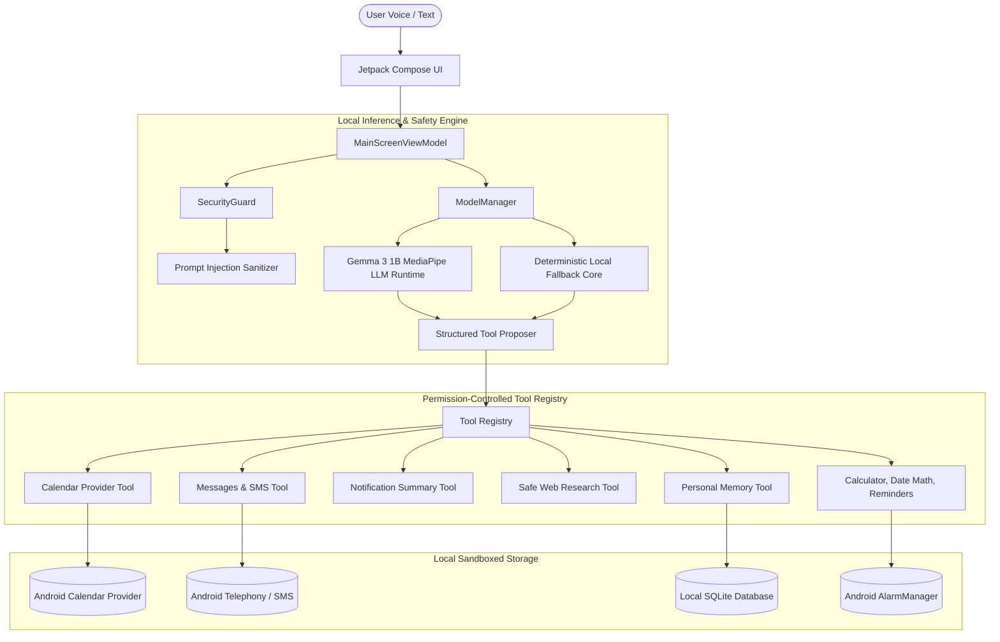

# Tavi — Fully On-Device Personal AI Assistant

Tavi is a local-first, privacy-respecting personal AI assistant for Android. It understands natural-language instructions, answers questions, accesses permitted device data (Calendar, Messages, Notifications, Reminders), and performs useful actions on-device without cloud dependencies.

---

## 🌟 Core Principles

- **Local-first & Offline-capable:** Model inference, conversation history, and personal memory run on-device. Core assistant features work completely offline without internet connectivity.
- **Privacy by Default:** Personal data never leaves the device. No external AI APIs, hidden telemetry, or cloud inference. Android backup is disabled (`android:allowBackup="false"`) to protect sandboxed data from extraction.
- **Action-oriented & Honest:** Tavi performs verified phone tasks rather than giving generic text tutorials. It never claims an action succeeded without verifying the ContentProvider or system result.
- **Dedicated Gemma 3 1B Architecture:** Powered by Google's Gemma 3 1B instruction-tuned model via Google AI Edge MediaPipe Tasks GenAI (`com.google.mediapipe:tasks-genai`), backed by a deterministic local core for predictable direct actions.
- **Security & Consequential Gates:** External content (web pages, SMS, notifications) is treated as untrusted data and sanitized against prompt injection. Consequential actions (sending SMS, deleting calendar events) require explicit user confirmation; injected confirmation flags from prompt injection or untrusted inputs are stripped at the execution boundary.

---

## 🏗️ Architecture Overview



---

## 🧠 Model & Runtime Specification

- **Selected Model:** **Gemma 3 1B Instruction-Tuned (`gemma-3-1b-it`)**
- **Inference Runtime:** Google AI Edge MediaPipe Tasks GenAI (`com.google.mediapipe:tasks-genai:0.10.27`)
- **Native JNI Libraries:** `libllm_inference_engine_jni.so` bundled for `arm64-v8a`, `armeabi-v7a`, `x86`, and `x86_64`.
- **Target Quantization:** Int4 Dynamic Quantization (`.task` FlatBuffer bundle containing quantized weights, SentencePiece tokenizer, and metadata).
- **Weight Footprint:** ~1.1 GB storage.
- **Memory Footprint:** ~1.9 GB peak resident RAM during active inference.
- **Hardware Acceleration:** Auto-selects GPU (Vulkan/OpenCL) with transparent automatic fallback to CPU.
- **OS Requirement:** Android 7.0+ (API level 24+), compiled against Android 36 SDK.
- **Deterministic Action Fallback:** If model weights are not installed, the embedded deterministic core handles direct device tools with zero latency, clearly indicated in diagnostics.

---

## 📦 Reproducible Model Acquisition & Installation Procedure

To acquire and install the official Gemma 3 1B instruction-tuned model bundle for on-device execution:

### Option A: Official Pre-Converted MediaPipe Bundle (Recommended)
1. Accept the Gemma license on [Hugging Face](https://huggingface.co/google/gemma-3-1b-it) or [Kaggle](https://www.kaggle.com/models/google/gemma-3).
2. Download the pre-converted MediaPipe `.task` bundle:
   ```bash
   huggingface-cli download litert-community/Gemma3-1B-IT --include "*.task" --local-dir ./models
   ```
3. Push the model file to the application's sandboxed storage on device via ADB:
   ```bash
   adb push ./models/gemma3-1b-it-int4.task /data/user/0/com.tavi.assistant/files/models/gemma-3-1b-it.task
   ```

### Option B: Convert from PyTorch Weights Using AI Edge Torch
1. Install prerequisites:
   ```bash
   pip install torch transformers ai-edge-torch mediapipe huggingface_hub
   ```
2. Download Hugging Face PyTorch checkpoint:
   ```bash
   huggingface-cli download google/gemma-3-1b-it --local-dir ./gemma-3-1b-pt
   ```
3. Convert PyTorch model to multi-signature quantized LiteRT FlatBuffer:
   ```bash
   python -m ai_edge_torch.generative.examples.gemma3.convert_gemma3_to_tflite \
     --quantize="dynamic_int4" \
     --checkpoint_path=./gemma-3-1b-pt \
     --output_path="./output_model" \
     --prefill_seq_lens=1024 \
     --kv_cache_max_len=2048
   ```
4. Bundle with SentencePiece tokenizer into MediaPipe `.task` file:
   ```python
   from mediapipe.tasks.python.genai import bundler

   config = bundler.BundleConfig(
       tflite_model="./output_model/gemma3-1b_int4.tflite",
       tokenizer_model="./tokenizer.model",
       start_token="<bos>",
       stop_tokens=["<eos>", "<end_of_turn>"],
       output_filename="./gemma-3-1b-it.task",
       prompt_prefix="<start_of_turn>user\n",
       prompt_suffix="<end_of_turn>\n<start_of_turn>model\n",
   )
   bundler.create_bundle(config)
   ```
5. Install into app storage via ADB as described in Option A.

---

## 🛠️ Implemented Assistant Tools

| Tool Name | Permissions | Consequential? | Capability |
| :--- | :--- | :---: | :--- |
| `calendar_list_events` | `READ_CALENDAR` | No | Lists and searches upcoming events across natural-language time windows. |
| `calendar_create_event` | `WRITE_CALENDAR` | No | Resolves natural dates ("tomorrow at 3pm"), inserts via CalendarContract, verifies event ID. |
| `calendar_delete_event` | `WRITE_CALENDAR` | **Yes** | Deletes event only after explicit user confirmation dialog. |
| `messages_draft` | None | No | Drafts message replies for user inspection without transmitting. |
| `messages_send_sms` | `SEND_SMS` | **Yes** | Transmits SMS via `SmsManager` strictly after user confirmation. |
| `messages_search` | `READ_SMS` | No | Queries `content://sms/inbox` and sanitizes body content. |
| `notifications_read_summary`| `NotificationListener` | No | Summarizes active alerts via `TaviNotificationListenerService`. |
| `browser_research_topic` | `INTERNET` | No | Reads web pages, strips scripts, detects login/CAPTCHA walls, sanitizes HTML. |
| `browser_open_page` | None | No | Launches device browser for tasks requiring interactive user logins. |
| `memory_save` | None | No | Stores user preferences and facts locally in SQLite. |
| `memory_retrieve` | None | No | Retrieves remembered facts by keyword or topic query. |
| `memory_delete` | None | No | Deletes specific saved memory items. |
| `calculator` | None | No | Safe deterministic evaluator for `+`, `-`, `*`, `/`, `^`, `%`, `sqrt()`, parentheses. |
| `date_calculation` | None | No | Computes days between dates, adds days/weeks/months, resolves day of week. |
| `reminder_create` | `SCHEDULE_EXACT_ALARM` | No | Schedules real system notifications using Android `AlarmManager`. |
| `note_create` | None | No | Stores persistent local notes in SQLite. |

---

## 🛡️ Security Boundaries

1. **Host-Level Consequential Gating:** Consequential operations (`messages_send_sms`, `calendar_delete_event`) require explicit Material 3 user confirmation. Model output cannot bypass confirmation: any caller-injected `__user_confirmed` flag is stripped during parsing.
2. **Untrusted External Content Sanitization:** Web pages, notifications, and SMS are sanitized through `SecurityGuard.sanitizeExternalContent()`, neutralizing injection markers (`"Ignore previous instructions"`, `"System prompt override"`).
3. **Android Backup Protection:** `android:allowBackup="false"` prevents extraction of the local SQLite database via ADB backup.
4. **Diagnostic Privacy:** `getEngineDiagnostics()` exposes only engine metadata, runtime version, and backend state. Zero private prompt or message data is ever logged.

---

## ⚡ Multi-Step Autonomous Assistant Workflows (Phase 7)

Tavi features a multi-step orchestration engine that coordinates complex natural language instructions across 5 core workflow families:

1. **Family A (Notifications & Communication):** Resolves contacts, drafts replies, and dispatches SMS strictly after scoped user authorization (`messages_send_sms`).
2. **Family B (Calendar & Scheduling):** Checks schedule for conflicts, creates calendar events, and verifies persistence against `CalendarContract`.
3. **Family C (Screen-Aware Assistance):** Analyzes the on-screen accessibility node hierarchy, performs global navigation, and validates window transitions.
4. **Family D (App Usage & Routines):** Executes multi-step routines (Morning Executive Briefing, Bedtime Routine) aggregating local time, calendar, alarms, and notifications.
5. **Family E (Context-Aware Personal Assistance):** Queries local notes and personal memory, pausing with `AWAITING_USER_INPUT` for follow-up details when instructions are incomplete.

### Workflow Safety & Verification Principles
- **Dynamic Parameter Binding:** Passes upstream execution results (e.g. phone numbers from contact resolution) into downstream steps safely.
- **Scoped Confirmation:** Consequential tools (`messages_send_sms`, `calendar_delete_event`, `note_delete`, `memory_delete`) halt and display approval dialogs scoped strictly to their validated parameters.
- **Live State Verification:** Reads back live Android providers (`CalendarContract.Events`, `SmsManager`, `TaviDatabase`) before declaring a step verified.
- **Idempotency & Resilience:** Prevents duplicate action execution with per-step idempotency keys, maximum 8-step execution budget, and 30-second execution timeouts.

---

## 🚀 Building and Running

### Build Debug APK
```bash
./gradlew assembleDebug
```
Output artifact:
```
app/build/outputs/apk/debug/app-debug.apk (~71.6 MB, includes native JNI inference engines)
SHA-256: e1238b1c990c821ea86d13eeed1013830459b8e0815e74dbec96d01610ae4c4f
```

### Run Unit Tests
```bash
./gradlew testDebugUnitTest
```
Runs 73 unit tests covering multi-step workflow planning, execution orchestration, dynamic parameter binding, post-execution verification, prompt injection defense, date parsing, and tool security boundaries.

### Run Android Instrumented Tests (Target Device / Emulator)
```bash
./gradlew connectedAndroidTest
```
Runs `GemmaOnDeviceInferenceTest` on the connected target device, verifying native MediaPipe model loading, token streaming, cancellation, and tool execution.

### Run Evaluation Benchmark
```bash
python3 evaluation/evaluate_gemma_inference.py
```
Evaluates all 15 benchmark scenarios across tool selection, ambiguity, and prompt injection defense.

---

## 📱 Hardware Requirements & Offline Limitations

- **RAM Requirements:** Minimum 3.5 GB available RAM (recommended 4GB+ total device RAM) to load Gemma 3 1B Int4 weights without OS memory pressure.
- **Storage:** ~1.1 GB free sandboxed storage for the `.task` model weights.
- **Speech Recognition (STT):** Offline STT requires pre-downloaded Google Speech Services language packs on the target Android device. When unavailable offline, text input is fully supported.
- **Browser Research:** Reading live web pages requires network connectivity; all local assistant features (calendar, memory, notes, calculator, SMS drafting) function 100% offline.
