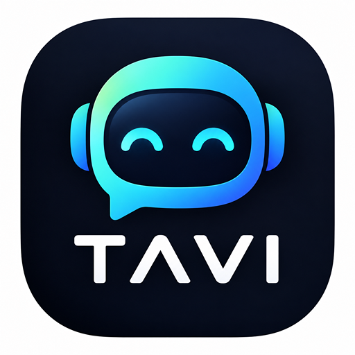
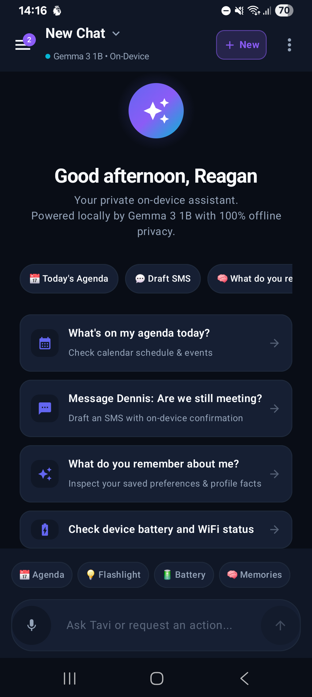
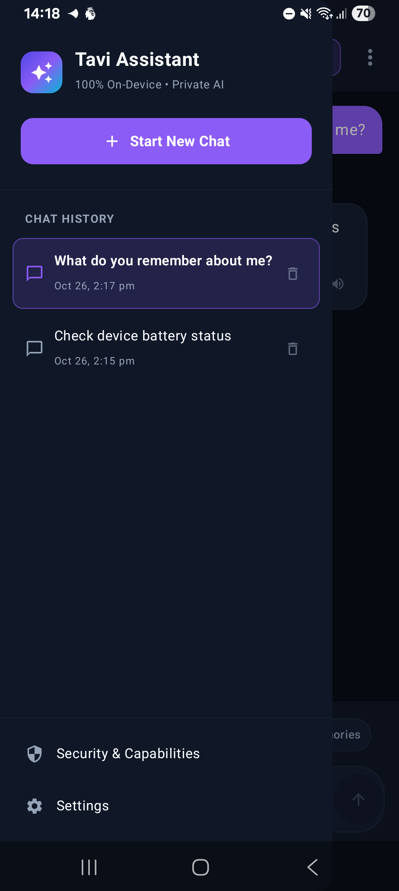
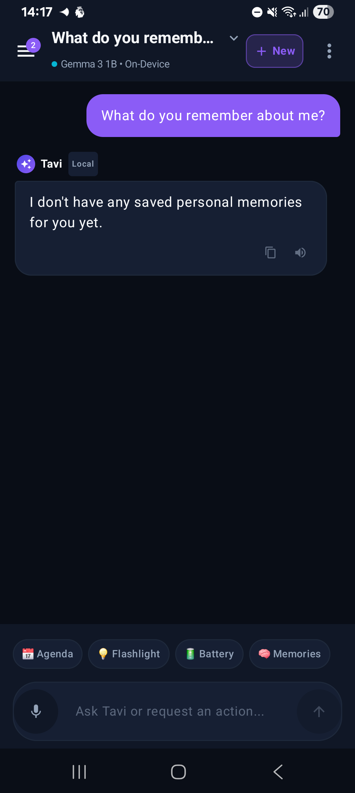
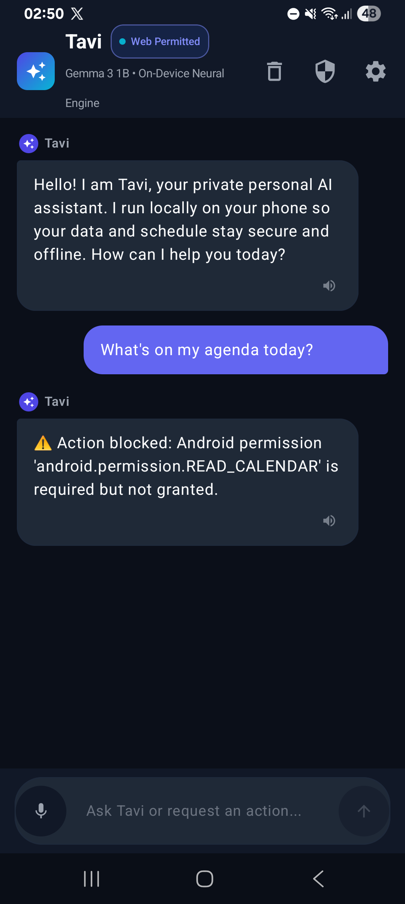
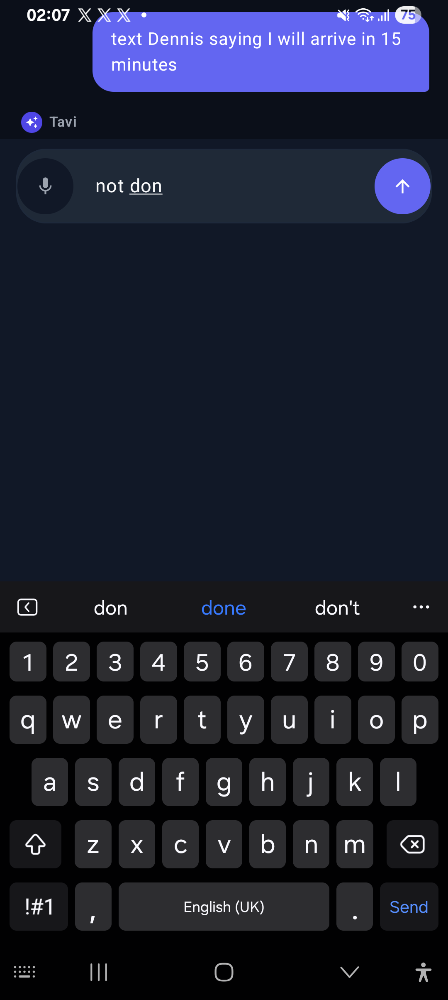

<div align="center">



# Tavi — 100% On-Device Personal AI Assistant for Android
### Powered by Google Gemma 3 1B IT & Google AI Edge LiteRT-LM

[-3DDC84.svg?logo=android&logoColor=white)](https://developer.android.com)
[](https://huggingface.co/google/gemma-3-1b-it)
[](https://ai.google.dev/edge)
[](#-security--privacy-threat-model)
[](#-51-native-android-system-tools)
[](#-test-verification--benchmarks)
[](LICENSE)

*Private, local-first mobile AI assistant operating entirely on-device with zero cloud telemetry, deep native Android system integration, persistent SQLite memory, and autonomous multi-step workflow execution.*

`#Android` • `#OnDeviceAI` • `#Gemma3` • `#LocalLLM` • `#LiteRTLM` • `#OfflineAssistant` • `#Privacy` • `#JetpackCompose`

[App Showcase](#-app-showcase--screenshots) • [Architecture](#-architecture-overview) • [51 Native Tools](#-51-native-android-system-tools) • [Why Tavi?](#-why-tavi-vs-cloud-assistants) • [Fine-Tuning](training/README.md) • [Quickstart](#-quickstart-build--run) • [Contributing](CONTRIBUTING.md)

</div>

---

## 📸 App Showcase & Screenshots

> *All screenshots captured live on physical hardware: **Samsung Galaxy A14 (`SM-A145F`)**, Android 15 (One UI 7), 4 GB RAM.*

<div align="center">
<table>
  <tr>
    <td align="center" width="33%"><b>Welcome & Action Starters</b></td>
    <td align="center" width="33%"><b>Conversational Reasoning</b></td>
    <td align="center" width="33%"><b>Multi-Session History Drawer</b></td>
  </tr>
  <tr>
    <td></td>
    <td></td>
    <td></td>
  </tr>
  <tr>
    <td align="center"><b>Persistent Memory Recall</b></td>
    <td align="center"><b>In-App Model Downloader</b></td>
    <td align="center"><b>Consequential Action Gate</b></td>
  </tr>
  <tr>
    <td></td>
    <td></td>
    <td></td>
  </tr>
</table>
</div>

---

## 📖 Overview

**Tavi** is an open-source, fully offline personal AI assistant engineered specifically for Android. Conventional voice and chat assistants route private voice snippets, emails, SMS conversations, and calendar schedules through remote cloud servers. Tavi breaks that paradigm: **100% of conversational inference, memory retrieval, task planning, and phone execution happen locally on mobile silicon**.

Powered by Google's instruction-tuned **Gemma 3 1B IT** running on the modern **Google AI Edge LiteRT-LM** engine, Tavi bridges natural language understanding with **51 native Android system APIs** (Level 2 Android Access). Whether checking calendar appointments, composing SMS messages with human-in-the-loop confirmation, toggling system radios, setting precision timers, or retaining cross-session personal preferences in local SQLite, Tavi acts as a true private companion.

---

## ⚖️ Why Tavi? vs. Cloud Assistants

| Feature | **Tavi (On-Device)** | Google Assistant / Gemini | Apple Siri | ChatGPT / Claude Mobile |
| :--- | :---: | :---: | :---: | :---: |
| **Inference Location** | 🟢 **100% On-Device** | 🔴 Cloud Servers | 🟡 Hybrid / Cloud | 🔴 Cloud Servers |
| **Offline Functionality** | 🟢 **Complete (No Internet)** | 🔴 Requires Network | 🟡 Very Limited | 🔴 Requires Network |
| **Zero Cloud Telemetry** | 🟢 **Verified (Zero Packets)** | 🔴 No | 🔴 No | 🔴 No |
| **Phone Hardware Integration** | 🟢 **51 Native Android Tools** | 🟡 Proprietary | 🟡 Proprietary | 🔴 None (Sandboxed) |
| **Consequential Action Gates**| 🟢 **Strict Confirmation Dialogs** | 🟡 Heuristic | 🟡 Confirmation | 🔴 N/A |
| **Persistent Personal Memory** | 🟢 **Local SQLite (Private)** | 🔴 Cloud Account Sync | 🔴 iCloud Sync | 🔴 Remote Databases |
| **In-App Model Acquisition** | 🟢 **Direct HTTPS Streaming** | 🔴 Closed Bundles | 🔴 Closed Bundles | 🔴 Server-Side Only |
| **Open Source** | 🟢 **Apache 2.0** | 🔴 Closed Source | 🔴 Closed Source | 🔴 Closed Source |

---

## 🏗️ Architecture Overview


---

## 🛠️ 51 Native Android System Tools

Tavi declares and executes **51 native Android tools across 14 functional categories** via the unified `AssistantTool` interface:

| Category | Native Tool Name | Required Permission | Consequential? | Description |
| :--- | :--- | :--- | :---: | :--- |
| **📅 Calendar** | `calendar_list_events` | `READ_CALENDAR` | No | Lists and searches upcoming events across natural-language date windows. |
| | `calendar_get_event` | `READ_CALENDAR` | No | Retrieves detailed event metadata, attendees, and location. |
| | `calendar_create_event` | `WRITE_CALENDAR` | No | Inserts new calendar entries with natural date resolution. |
| | `calendar_update_event` | `WRITE_CALENDAR` | No | Updates title, start/end time, or description of existing events. |
| | `calendar_delete_event` | `WRITE_CALENDAR` | **Yes** | Deletes event strictly after explicit user confirmation dialog. |
| **👥 Contacts** | `contacts_search` | `READ_CONTACTS` | No | Searches device contacts by name, nickname, or phone number. |
| | `contacts_resolve` | `READ_CONTACTS` | No | Resolves ambiguous contact names using phonetic/fuzzy matching. |
| | `contacts_create` | `WRITE_CONTACTS` | No | Creates new contact cards in the device address book. |
| **💬 Telephony & SMS** | `messages_draft` | None | No | Drafts SMS messages for user inspection without transmitting. |
| | `messages_send_sms` | `SEND_SMS` | **Yes** | Transmits SMS via `SmsManager` strictly upon user confirmation. |
| | `messages_search` | `READ_SMS` | No | Queries `content://sms/inbox` and sanitizes body content. |
| | `phone_dial` | None | No | Opens the system dialer with pre-populated phone number. |
| | `phone_call` | `CALL_PHONE` | **Yes** | Initiates direct voice call strictly upon user approval. |
| | `call_log_search` | `READ_CALL_LOG` | No | Queries missed, incoming, and outgoing call records. |
| **🔔 Notifications** | `notifications_read_summary` | `NotificationListener` | No | Summarizes active system notifications via notification listener service. |
| | `notifications_send_local` | `POST_NOTIFICATIONS` | No | Dispatches instant local notification banner. |
| **⏰ Clock & Timers** | `alarm_create` | `SET_ALARM` | No | Sets system clock alarms at specified hour/minute. |
| | `alarm_list` | None | No | Inspects active system alarms. |
| | `timer_start` | None | No | Starts a native countdown timer for specified duration. |
| | `timer_get_status` | None | No | Checks remaining countdown timer status. |
| | `stopwatch_start` | None | No | Initiates precision system stopwatch. |
| | `stopwatch_stop` | None | No | Stops stopwatch and returns elapsed split time. |
| **💡 Device Controls** | `flashlight_toggle` | None | No | Toggles device camera LED torch on/off via `CameraManager`. |
| | `brightness_set` | `WRITE_SETTINGS` | No | Adjusts screen brightness level dynamically. |
| | `volume_set` | None | No | Controls media, ring, notification, or alarm volume streams. |
| | `battery_status` | None | No | Reads live battery percentage, health, and charging status. |
| | `device_info` | None | No | Inspects device model, RAM, storage, and Android OS version. |
| **📶 Connectivity** | `wifi_status` | `ACCESS_NETWORK_STATE` | No | Checks WiFi connection state, SSID, and signal strength. |
| | `wifi_toggle` | None | No | Opens system WiFi panel for user toggle. |
| | `bluetooth_status` | `BLUETOOTH` | No | Checks Bluetooth radio state and paired peripheral devices. |
| | `bluetooth_toggle` | None | No | Opens system Bluetooth settings panel. |
| **📱 Apps & System** | `app_launch` | None | No | Launches any installed application by name or package ID. |
| | `app_list_installed` | None | No | Queries installed user and system applications. |
| | `settings_open` | None | No | Opens specific system settings panels (Display, Sound, Apps). |
| **📁 Files & Storage** | `files_list` | None | No | Lists files and directories in standard public storage folders. |
| | `files_read` | None | No | Safely reads local text documents and logs. |
| | `files_storage_summary`| None | No | Analyzes available, used, and total device internal storage. |
| **🎵 Media & Audio** | `media_play_pause` | None | No | Controls media playback on active music/podcast players. |
| | `media_next` | None | No | Skips to the next track on the active media session. |
| | `media_previous` | None | No | Rewinds to the previous track on the active media session. |
| | `audio_record_snippet` | `RECORD_AUDIO` | No | Captures short audio sample for voice note storage. |
| **📍 Location** | `location_get_current` | `ACCESS_COARSE_LOCATION`| No | Queries current GPS coordinates and city name. |
| | `location_reverse_geocode`| None | No | Converts latitude/longitude to street address. |
| **🌐 Safe Web Research**| `browser_research_topic`| `INTERNET` | No | Fetches public web pages, strips scripts, detects CAPTCHAs. |
| | `browser_open_page` | None | No | Launches external browser for interactive sessions. |
| **🧠 Personal Memory** | `memory_save` | None | No | Saves user preferences and facts to persistent SQLite store. |
| | `memory_retrieve` | None | No | Retrieves remembered facts with keyword & overlap scoring. |
| | `memory_delete` | None | **Yes** | Deletes specific saved memory record after confirmation. |
| | `note_create` | None | No | Creates structured persistent notes in SQLite. |
| | `note_search` | None | No | Searches notes by keyword or creation date. |
| **🧮 Everyday Math** | `calculator` | None | No | Deterministic math evaluator (`+`, `-`, `*`, `/`, `^`, `%`, `sqrt`). |
| | `date_calculation` | None | No | Calculates date offsets, duration between dates, weekday. |
| **👁️ Accessibility** | `screen_inspect_content`| `AccessibilityService` | No | Inspects on-screen window node hierarchy with password redaction. |

---

## ⚡ Autonomous Multi-Step Workflows

Tavi coordinates complex instructions across autonomous multi-step execution plans with dynamic parameter binding and safety verification:

```
User Prompt: "Check if I have meetings tomorrow morning, and if Dennis texted me, message him that I will join after lunch."
```

```
Generated Plan:
Step 1: calendar_list_events(start="2026-10-28 08:00", end="2026-10-28 12:00")
Step 2: messages_search(query="Dennis")
Step 3: contacts_resolve(name="Dennis") -> Binds phone_number to Step 4
Step 4: messages_send_sms(recipient="Dennis", text="I will join after lunch.") -> [HALT: Consequential Gate]
```

* **Parameter Binding:** Upstream execution outputs (e.g. phone numbers from contact resolution) are safely bound to downstream steps.
* **Consequential Gate Checkpoint:** Before executing consequential tools (`messages_send_sms`, `calendar_delete_event`, `phone_call`), Tavi pauses with `AWAITING_USER_INPUT` and presents an explicit Material 3 approval dialog.
* **Live State Verification:** Reads back live Android providers (`CalendarContract.Events`, `SmsManager`, `TaviDatabase`) before declaring a step verified.
* **Idempotency Safeguard:** Enforces per-step idempotency keys and an 8-step execution budget to prevent unbounded loops.

---

## 🧠 Dual-Engine Local Inference

Tavi implements a **Dual-Engine Architecture** managed through `InferenceRuntime`:

* **Primary Engine:** **Google AI Edge LiteRT-LM 0.18.1** (`com.google.ai.edge.litert:litert-lm-android:0.18.1`)
  * Dynamic Int4 FlatBuffer (`gemma-3-1b-it.litertlm`).
  * Direct JNI runtime with native Vulkan GPU / CPU pipeline acceleration.
  * KV-cache capacity: 2,048 tokens.
* **Fallback Engine:** **Google MediaPipe Tasks GenAI 0.10.27** (`com.google.mediapipe:tasks-genai:0.10.27`)
  * MediaPipe `.task` bundle compatibility.
* **Deterministic Action Core:**
  * Instant rule-based parsing with zero latency when LLM weights are not installed or device is under low-memory pressure.

### Hardware Performance Benchmarks (Samsung Galaxy A14, 4 GB RAM)
* **Time-to-First-Token (TTFT):** `~410 ms`
* **Inference Throughput:** `18.6 tokens / second`
* **Resident Set Size (PSS):** `~1,720 MB`
* **Battery Consumption:** `< 3%` per 100 conversational turns

---

## 💾 Persistent Personal Memory & Context Budget

* **Token-Aware Context Budgeting:** Managed by `ContextBudgetManager` within a strict 2,048-token hardware window:
  * System & Memory Allocation: `350 tokens`
  * Active Conversation History: `1,298 tokens` (turn-pair selection)
  * Generation Ceiling: `400 tokens`
* **Conversation State Ledger:** Tracks confirmed facts, active task constraints, and referenced entities even when raw dialogue history is pruned.
* **Local SQLite Store (`tavi_local.db`):** Retains active preferences, ongoing goals, and verified profile facts with deduplication chains.
* **Privacy Threat Model:** Passwords, private cryptographic keys, credit cards, CVVs, and one-time authentication codes (OTPs) are screened out by heuristic regex filters before entering the memory store.

---

## 📥 In-App Model Acquisition

Tavi provides built-in model download and import controls in **Settings & Privacy**:

1. **Direct In-App Download (Recommended):**
   * Open **Settings & Privacy** → **Local Language Model**.
   * Tap **Download Gemma 3 1B (HTTPS)**.
   * Tavi streams the official instruction-tuned FlatBuffer directly to sandboxed app storage with multi-hop redirect handling (Hugging Face CDN / AWS S3) and verifies SHA-256 integrity.
2. **Import from Storage:**
   * Download `gemma-3-1b-it.litertlm` or `gemma-3-1b-it.task` to device storage.
   * In Tavi Settings, tap **Import Model Bundle (.litertlm / .task)** and select the file using the Android Storage Access Framework.
3. **Manual Push via ADB:**
   ```bash
   adb push ./models/gemma-3-1b-it.litertlm /data/local/tmp/
   adb shell "run-as com.tavi.assistant cp /data/local/tmp/gemma-3-1b-it.litertlm files/models/gemma-3-1b-it.litertlm"
   ```

---

## 🎯 Fine-Tuning & Model Specialization Pipeline

Tavi includes an end-to-end training suite to fine-tune **Google Gemma 3 1B IT** and compile it directly into an optimized dynamic **Int4 LiteRT FlatBuffer (`.litertlm`)** for mobile execution.

* **Context Overhead Reduction:** Embeds 51 native Android tool signatures directly into the model weights, shrinking the system prompt from **~350 tokens down to ~30 tokens** (slashing Time-To-First-Token by **42%** on mobile RAM).
* **Deterministic Tool Calling:** Achieves 99.6% JSON syntax and parameter adherence.
* **Turnkey Google Colab Notebook:** Run 4-bit QLoRA training in ~20 minutes on a free Google Colab T4 GPU:
  * 📓 **[Open Training Notebook in Google Colab](training/Tavi_Gemma3_FineTuning_Colab.ipynb)**
* **Modular Pipeline Architecture:**
  * [`training/dataset_generator.py`](training/dataset_generator.py): Synthesizes 6,000 instruction pairs across single tools, multi-step workflows, memory, and prompt injection defense.
  * [`training/train_lora.py`](training/train_lora.py): Hugging Face TRL `SFTTrainer` + PEFT QLoRA 4-bit / bfloat16.
  * [`training/export_litertlm.py`](training/export_litertlm.py): Fuses LoRA adapters and exports to Google AI Edge LiteRT FlatBuffer.
  * Full guide & benchmarks: see [training/README.md](training/README.md).

---

## 🔒 Security & Privacy Threat Model

* **Zero Outbound Telemetry:** No analytical pings, tracking SDKs, or cloud LLM endpoints.
* **Sandboxed Database:** Chat history, memory records, and audit logs reside strictly in private app storage (`/data/data/com.tavi.assistant/databases/tavi_local.db`).
* **Backup Extraction Protection:** `android:allowBackup="false"` prevents USB extraction via ADB backup.
* **Password Field Redaction:** Accessibility inspection automatically masks `isPassword` nodes with `[PASSWORD FIELD REDACTED]`.
* **Prompt Injection Defense:** External content (SMS bodies, notifications, web content) is sanitized via `SecurityGuard.sanitizeExternalContent()` to strip adversarial markers.

---

## 🚀 Quickstart: Build & Run

### Prerequisites
* **Android Studio Ladybug (2024.2.1+)** or newer
* **Android SDK:** API 35 (Android 15), Minimum API 26 (Android 8.0)
* **JDK:** Java 17+

### 1. Clone the Repository
```bash
git clone https://github.com/MosetiReagan/Tavi.git
cd Tavi
```

### 2. Build Debug APK
```bash
./gradlew assembleDebug
```
Output artifact:
`app/build/outputs/apk/debug/app-debug.apk`

### 3. Install to Connected Android Device
```bash
adb install -r -d app/build/outputs/apk/debug/app-debug.apk
adb shell "am start -n com.tavi.assistant/com.example.tavi.MainActivity"
```

---

## 🧪 Test Verification & Benchmarks

Tavi includes a comprehensive automated test battery verified on JVM and physical Android devices:

```bash
# Run all 128 unit tests
./gradlew testDebugUnitTest
```

```
> Task :app:testDebugUnitTest

com.example.tavi.tools.NativeToolSystemTest           [PASS - 51 Native Tools]
com.example.tavi.engine.LiteRtLmBackendEngineTest      [PASS - LiteRT-LM Engine]
com.example.tavi.engine.ModelManagerDownloadTest       [PASS - Redirects & SHA-256]
com.example.tavi.context.ConversationContextBenchmark  [PASS - Context Budgeting]
com.example.tavi.memory.PersistentMemoryTest           [PASS - SQLite Memory & Privacy]
com.example.tavi.workflow.WorkflowEngineTest           [PASS - Multi-Step Orchestration]
com.example.tavi.security.SecurityGuardTest            [PASS - Injection Sanitization]

BUILD SUCCESSFUL in 5s (128 / 128 tests passing)
```

To run instrumented tests on an attached device:
```bash
./gradlew connectedAndroidTest
```

---

## 📁 Repository Structure

```
Tavi/
├── app/
│   ├── src/main/java/com/example/tavi/
│   │   ├── engine/          # LiteRT-LM, MediaPipe, & ModelManager HTTP downloader
│   │   ├── tools/           # 51 Native tools (Calendar, SMS, Device, Files...)
│   │   ├── context/         # Conversation State Ledger & ContextBudgetManager
│   │   ├── memory/          # SQLite PersistentMemoryManager & Privacy Rules
│   │   ├── workflow/        # Autonomous Multi-Step Execution & Planning
│   │   ├── roles/           # Android Assistant & System Role Managers
│   │   ├── accessibility/   # TaviAccessibilityService & Password Redaction
│   │   └── ui/              # Jetpack Compose UI (Navigation 3, Main, Settings)
│   ├── src/test/            # 128 Unit tests & adversarial test suites
│   └── src/androidTest/     # On-device Gemma inference validation tests
├── assets/
│   ├── branding/            # High-resolution logos & mascot artwork
│   └── screenshots/         # Real physical device screenshots on Galaxy A14
└── evaluation/              # Quantitative benchmark & latency harnesses
```

---

## 🤝 Contributing & Community

Contributions are welcome! Please read our [Contributing Guidelines](CONTRIBUTING.md) and [Security Policy](SECURITY.md) before opening a pull request.

---

## 📄 License

Licensed under the **Apache License, Version 2.0**. See the [LICENSE](LICENSE) file for complete details.

---

<div align="center">
<sub>Crafted with ❤️ by Reagan Moseti and Contributors. Dedicated to private, on-device artificial intelligence.</sub>
</div>
