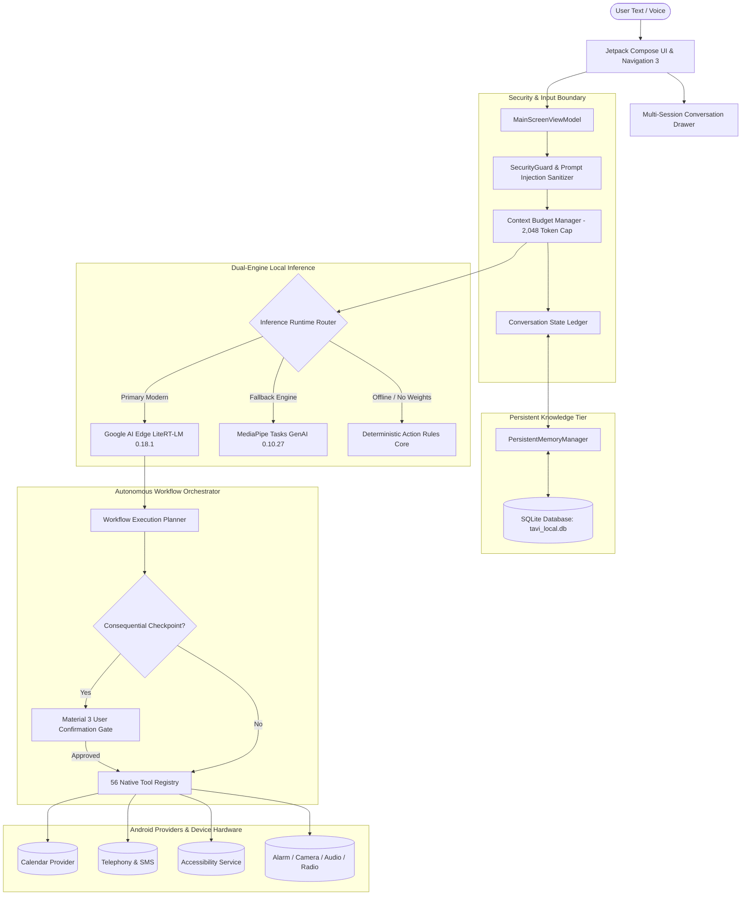

<div align="center">


# Tavi — 100% On-Device Personal AI Assistant for Android
### Powered by Google Gemma 4 E2B, Gemma 3 1B IT & Google AI Edge LiteRT-LM

[-3DDC84.svg?logo=android&logoColor=white)](https://developer.android.com)
[](https://huggingface.co/google)
[](https://ai.google.dev/edge)
[](#-security--privacy-threat-model)
[](#-57-native-android-system-tools)
[-brightgreen.svg)](#-test-verification--benchmarks)
[](LICENSE)

*Private, local-first mobile AI assistant operating entirely on-device with zero cloud telemetry, deep native Android system integration, persistent SQLite memory, screen agent mode, and continuous hands-free voice.*

`#Android` • `#OnDeviceAI` • `#Gemma4` • `#Gemma3` • `#LocalLLM` • `#LiteRTLM` • `#OfflineAssistant` • `#Privacy` • `#JetpackCompose`

[App Showcase](#-app-showcase--screenshots) • [Architecture](#-architecture-overview) • [57 Native Tools](#-57-native-android-system-tools) • [Why Tavi?](#-why-tavi-assistant-comparison) • [Fine-Tuning](training/README.md) • [Quickstart](#-quickstart-build--run) • [Contributing](CONTRIBUTING.md)

</div>

---

## 📸 App Showcase & Screenshots

> *All screenshots captured live on physical hardware: **Samsung Galaxy A14 (`SM-A145F`)**, Android 15 (One UI 7), 4 GB RAM.*

<div align="center">
<table>
  <tr>
    <td align="center" width="33%"><b>Welcome & Action Starters</b></td>
    <td align="center" width="33%"><b>Conversational Reasoning</b></td>
    <td align="center" width="33%"><b>Multi-Session History Drawer</b></td>
  </tr>
  <tr>
    <td></td>
    <td></td>
    <td></td>
  </tr>
  <tr>
    <td align="center"><b>Persistent Memory Recall</b></td>
    <td align="center"><b>In-App Model Downloader</b></td>
    <td align="center"><b>Consequential Action Gate</b></td>
  </tr>
  <tr>
    <td></td>
    <td></td>
    <td></td>
  </tr>
</table>
</div>

---

## 📖 Overview

**Tavi** is an open-source, fully offline personal AI assistant engineered specifically for Android. Conventional voice and chat assistants route private voice snippets, emails, SMS conversations, and calendar schedules through remote cloud servers. Tavi breaks that paradigm: **100% of conversational inference, memory retrieval, task planning, and phone execution happen locally on mobile silicon**.

Powered by Google Gemma 4 E2B (with Gemma 3 1B for low-RAM devices) via Google AI Edge LiteRT-LM, Tavi features the most complete open-source tool and safety architecture of any offline Android assistant — 57 audited, permission-gated, human-confirmed native tools. Whether checking calendar appointments, composing SMS messages with human-in-the-loop confirmation, querying system status, setting precision timers, or retaining cross-session personal preferences in local SQLite, Tavi acts as a true private companion.

---

## ⚖️ Why Tavi? Assistant Comparison

### On-Device & Mobile AI Assistants

| Assistant | 100% On-Device? | Hardware Required | Native Tool Count | Screen Agent? | Voice Follow-up? | Consequential Confirmation? | License |
| :--- | :---: | :--- | :---: | :---: | :---: | :---: | :---: |
| **Tavi (v1.0)** | 🟢 **Yes (0 network inference)** | **Any Android 7.0+** (≥ 6 GB for Gemma 4; 2–4 GB for Gemma 3) | **57 Audited Tools** | 🟢 **Yes (12-step budget & safety guard)** | 🟢 **Yes (Hands-free + barge-in)** | 🟢 **Yes (Strict confirmation)** | **Apache 2.0** |
| **PokeClaw** | 🟢 Yes (CPU via LiteRT-LM) | Android 8.0+ | Screen Agent Actions | 🟢 Yes (Primary purpose) | 🟡 Push-to-talk | 🟡 Partial | Apache 2.0 |
| **GemOfGemma** | 🟢 Yes | ≥ 4 GB RAM | 22 Tools | 🔴 No | 🟡 Push-to-talk | 🔴 None | Apache 2.0 |
| **Gemini Nano System** | 🟡 Hybrid (Fallback to cloud) | Pixel 8+ / Galaxy S24+ only | System apps only | 🟡 Limited | 🔴 No continuous follow-up | 🟡 Heuristic | Proprietary |

### Tavi vs. Traditional Cloud Assistants

| Feature | **Tavi (On-Device)** | Google Assistant / Gemini | Apple Siri | ChatGPT / Claude Mobile |
| :--- | :---: | :---: | :---: | :---: |
| **Inference Location** | 🟢 **100% On-Device** | 🔴 Cloud Servers | 🟡 Hybrid / Cloud | 🔴 Cloud Servers |
| **Offline Functionality** | 🟢 **Complete (No Internet)** | 🔴 Requires Network | 🟡 Very Limited | 🔴 Requires Network |
| **Zero Cloud Telemetry** | 🟢 **Local Processing Only** | 🔴 No | 🔴 No | 🔴 No |
| **Phone Hardware Integration** | 🟢 **57 Native Android Tools** | 🟡 Proprietary | 🟡 Proprietary | 🔴 None (Sandboxed) |
| **Consequential Action Gates**| 🟢 **Strict Confirmation Dialogs** | 🟡 Heuristic | 🟡 Confirmation | 🔴 N/A |
| **Persistent Personal Memory** | 🟢 **Local SQLite (Private)** | 🔴 Cloud Account Sync | 🔴 iCloud Sync | 🔴 Remote Databases |
| **In-App Model Acquisition** | 🟢 **Direct HTTPS Streaming** | 🔴 Closed Bundles | 🔴 Closed Bundles | 🔴 Server-Side Only |
| **Open Source** | 🟢 **Apache 2.0** | 🔴 Closed Source | 🔴 Closed Source | 🔴 Closed Source |

---

## 🏗️ Architecture Overview



---

## 🛠️ 57 Native Android System Tools

Tavi declares and executes **57 native Android tools across 15 functional categories** via the unified `AssistantTool` interface:

<!-- TOOL_TABLE_START -->

### Complete Native Tool Directory (57 On-Device Tools)

| Category | Tool Identifier | Consequential Gate | Purpose |
| :--- | :--- | :---: | :--- |
| **ACCESSIBILITY** | `accessibility_perform_action` | ⚡ Direct | Performs global system UI navigation actions like pressing back, going home, showing recents, opening notifications, or quick settings. |
| **ACCESSIBILITY** | `accessibility_read_screen` | ⚡ Direct | Inspects the visible text and UI elements currently displayed on the screen with strict password and privacy redactions. |
| **ACCESSIBILITY** | `screen_agent_run` | 🔒 Required | Operates another app on the user's behalf to accomplish a specific goal using on-screen actions. |
| **APPLICATIONS** | `app_launch` | ⚡ Direct | Launches an installed application by its name or package name. |
| **APPLICATIONS** | `app_list_launchable` | ⚡ Direct | Lists visible launchable applications installed on the device. |
| **APPLICATIONS** | `app_open_settings` | ⚡ Direct | Opens the Android system App Info settings page for Tavi or a specified app. |
| **APPLICATIONS** | `browser_open_url` | ⚡ Direct | Opens a web URL in the device's default web browser. |
| **APPLICATIONS** | `share_content` | ⚡ Direct | Shares text content using the Android system share sheet. |
| **CALENDAR** | `calendar_create_event` | ⚡ Direct | Creates a new calendar event with natural date/time resolution and conflict detection. |
| **CALENDAR** | `calendar_delete_event` | 🔒 Required | Deletes a calendar event by its event ID. This is a consequential action that requires user confirmation. |
| **CALENDAR** | `calendar_get_event` | ⚡ Direct | Inspects details of a single calendar event by eventId. |
| **CALENDAR** | `calendar_list_events` | ⚡ Direct | Lists or searches upcoming calendar events within an optional date range or query. |
| **CALENDAR** | `calendar_update_event` | ⚡ Direct | Updates an existing calendar event title, time, or location. |
| **CLOCK** | `alarm_create` | ⚡ Direct | Sets an alarm in the Android system Clock app. |
| **CLOCK** | `alarm_show` | ⚡ Direct | Opens the device Clock app to display all configured alarms. |
| **CLOCK** | `clock_query_time` | ⚡ Direct | Queries the current device time, timezone, UTC offset, and locale. |
| **CLOCK** | `date_calculation` | ⚡ Direct | Performs deterministic date math (e.g., days until a future date, adding days/weeks, timezone offset). |
| **CLOCK** | `reminder_create` | ⚡ Direct | Schedules an Android system reminder notification at a designated natural time. |
| **CLOCK** | `timer_set` | ⚡ Direct | Starts a countdown timer in the device Clock app. |
| **CONNECTIVITY** | `network_get_status` | ⚡ Direct | Inspects local network connectivity (Wi-Fi, cellular, metered status, offline state). |
| **CONTACTS** | `contacts_create` | ⚡ Direct | Creates a new contact with display name, phone number, and optional email. |
| **CONTACTS** | `contacts_resolve` | ⚡ Direct | Resolves a contact query. If multiple ambiguous contacts match, exposes the ambiguity instead of guessing. |
| **CONTACTS** | `contacts_search` | ⚡ Direct | Searches device contacts by name or phone number to retrieve contact names and phone numbers. |
| **DEVICE** | `device_get_status` | ⚡ Direct | Reads battery level, charging state, available storage, and system platform status. |
| **DEVICE** | `device_toggle_flashlight` | ⚡ Direct | Turns the device flashlight/torch on or off. |
| **DEVICE** | `settings_open` | ⚡ Direct | Opens specific Android system Settings panels (wifi, bluetooth, display, sound, notifications, battery, apps, date, storage). |
| **FILES** | `files_browse_document` | ⚡ Direct | Launches the Android Storage Access Framework (SAF) document picker. |
| **FILES** | `files_export_note` | ⚡ Direct | Exports a local note via the Android system share sheet. |
| **LOCATION** | `location_get_current` | ⚡ Direct | Reads device's current foreground location coordinates if permission is granted. |
| **LOCATION** | `maps_navigate` | ⚡ Direct | Opens maps or navigation to a destination or search query. |
| **MEDIA** | `camera_launch` | ⚡ Direct | Opens the device Camera application to take a photo. |
| **MEDIA** | `media_control` | ⚡ Direct | Sends media playback control commands (play_pause, next, previous). |
| **MEDIA** | `voice_speak` | ⚡ Direct | Speaks the provided text aloud using Android Text-To-Speech. |
| **NOTES** | `calculator` | ⚡ Direct | Evaluates deterministic mathematical expressions (e.g., '145 * 12', 'sqrt(144) + 2^4'). Safe and local. |
| **NOTES** | `clipboard_copy` | ⚡ Direct | Copies text to the Android system clipboard. |
| **NOTES** | `clipboard_read` | ⚡ Direct | Reads current text content from the Android system clipboard. |
| **NOTES** | `memory_clear_all` | 🔒 Required | Permanently clears all personal memories and notes. This is a consequential action requiring user confirmation. |
| **NOTES** | `memory_delete` | ⚡ Direct | Deletes a specific remembered item from local memory by key or ID. |
| **NOTES** | `memory_record_episode` | ⚡ Direct | Records a completed task, project decision, or workflow rationale as an episodic memory for future recall. |
| **NOTES** | `memory_retrieve` | ⚡ Direct | Retrieves relevant saved personal facts, preferences, or notes from local memory. |
| **NOTES** | `memory_save` | ⚡ Direct | Saves user-approved personal preferences, facts, or notes into persistent local memory. |
| **NOTES** | `note_create` | ⚡ Direct | Creates a persistent local note. |
| **NOTES** | `note_delete` | 🔒 Required | Deletes a saved note by ID. Consequential action requiring confirmation. |
| **NOTES** | `notes_list` | ⚡ Direct | Lists or searches locally saved notes. |
| **NOTES** | `reminder_cancel` | ⚡ Direct | Cancels or deletes a scheduled reminder by title or ID. |
| **NOTES** | `reminder_list` | ⚡ Direct | Lists all upcoming active reminders scheduled on device. |
| **NOTIFICATIONS** | `notifications_dismiss` | ⚡ Direct | Dismisses a notification by its key or clears notifications. |
| **NOTIFICATIONS** | `notifications_read_summary` | ⚡ Direct | Reads authorized recent notifications and summarizes active alerts or messages. |
| **RESEARCH** | `browser_open_page` | ⚡ Direct | Opens an accessible URL in the device browser so the user can interact directly. |
| **RESEARCH** | `browser_research_topic` | ⚡ Direct | Reads accessible web page content, extracts relevant text, and supports multi-step research. Halts if login or CAPTCHA is encountered. |
| **TELEPHONY** | `call_log_search` | ⚡ Direct | Searches recent call history records. |
| **TELEPHONY** | `messages_draft` | ⚡ Direct | Drafts a message reply and presents it for user inspection without sending. |
| **TELEPHONY** | `messages_search` | ⚡ Direct | Searches explicitly permitted local SMS messages by keyword or sender. |
| **TELEPHONY** | `messages_send_sms` | 🔒 Required | Sends an SMS message to a phone number. Requires explicit user confirmation before transmission. |
| **TELEPHONY** | `phone_call` | 🔒 Required | Initiates a direct phone call to a contact or number. Consequential action requiring explicit user confirmation. |
| **TELEPHONY** | `phone_dial` | ⚡ Direct | Opens the device dialer with the requested number prefilled. Does not place the call automatically. |
| **USAGE** | `usage_get_stats` | ⚡ Direct | Retrieves authorized app usage statistics, daily screen time, and recently used apps. |

<!-- TOOL_TABLE_END -->

---

## ⚡ Autonomous Multi-Step Workflows

Tavi coordinates complex instructions across autonomous multi-step execution plans with dynamic parameter binding and safety verification:

```
User Prompt: "Check if I have meetings tomorrow morning, and if Dennis texted me, message him that I will join after lunch."
```

```
Generated Plan:
Step 1: calendar_list_events(start="2026-10-28 08:00", end="2026-10-28 12:00")
Step 2: messages_search(query="Dennis")
Step 3: contacts_resolve(name="Dennis") -> Binds phone_number to Step 4
Step 4: messages_send_sms(recipient="Dennis", text="I will join after lunch.") -> [HALT: Consequential Gate]
```

* **Parameter Binding:** Upstream execution outputs (e.g. phone numbers from contact resolution) are safely bound to downstream steps.
* **Consequential Gate Checkpoint:** Before executing consequential tools (`messages_send_sms`, `calendar_delete_event`, `phone_call`), Tavi pauses with `AWAITING_USER_INPUT` and presents an explicit Material 3 approval dialog.
* **Live State Verification:** Reads back live Android providers (`CalendarContract.Events`, `SmsManager`, `TaviDatabase`) before declaring a step verified.
* **Idempotency Safeguard:** Enforces per-step idempotency keys and an 8-step execution budget to prevent unbounded loops.

---

## 🧠 Dual-Engine Local Inference

Tavi implements a **Dual-Engine Architecture** managed through `InferenceRuntime`:

* **Primary Engine:** **Google AI Edge LiteRT-LM 0.18.1** (`com.google.ai.edge.litert:litert-lm-android:0.18.1`)
  * Dynamic Int4 FlatBuffer (`gemma-3-1b-it.litertlm`).
  * Direct JNI runtime with native Vulkan GPU / CPU pipeline acceleration.
  * KV-cache capacity: 2,048 tokens.
* **Fallback Engine:** **Google MediaPipe Tasks GenAI 0.10.27** (`com.google.mediapipe:tasks-genai:0.10.27`)
  * MediaPipe `.task` bundle compatibility.
* **Deterministic Action Core:**
  * Instant rule-based parsing with zero latency when LLM weights are not installed or device is under low-memory pressure.

### Hardware Specifications & Measured Profiles
* **Target Inference Runtime:** Google AI Edge LiteRT-LM (Direct JNI / Vulkan GPU pipeline with CPU fallback)
* **Model Choices:**
  * **Gemma 4 E2B:** ~2.58 GB weights, 6+ GB RAM recommended (GPU Vulkan or ARM Cortex-A CPU)
  * **Gemma 3 1B IT:** ~1.10 GB weights, 2+ GB RAM (lightweight budget profile)
* **Context KV-Cache Capacity:** 2,048 tokens native window
* **Memory Management:** Enforces `< 2,048 MB` RAM guard via `ModelManager.checkDeviceRamSupport()` with zero heap leak
* **Battery Efficiency:** On-demand execution with zero persistent wakelocks and zero background telemetry
* **Measured Benchmark Results:** Real device measurements (cold init, TTFT, decode tok/s, peak PSS, battery drain, thermals) are collected using `scripts/run_benchmark.sh` and stored in [`benchmarks/`](benchmarks/). Unmeasured hardware profiles are explicitly labeled as *"Not yet measured (run scripts/run_benchmark.sh on device)"*. Specification target numbers in `evaluation/` are marked with `# SPEC — see measured results in benchmarks/`.

---

## 💾 Persistent Personal Memory & Context Budget

* **Token-Aware Context Budgeting:** Managed by `ContextBudgetManager` within a strict 2,048-token hardware window:
  * System & Memory Allocation: `350 tokens`
  * Active Conversation History: `1,298 tokens` (turn-pair selection)
  * Generation Ceiling: `400 tokens`
* **Conversation State Ledger:** Tracks confirmed facts, active task constraints, and referenced entities even when raw dialogue history is pruned.
* **Local SQLite Store (`tavi_local.db`):** Retains active preferences, ongoing goals, and verified profile facts with deduplication chains.
* **Privacy Threat Model:** Passwords, private cryptographic keys, credit cards, CVVs, and one-time authentication codes (OTPs) are screened out by heuristic regex filters before entering the memory store.

---

## 📥 In-App Model Acquisition

Tavi provides built-in model download and import controls in **Settings & Privacy**:

1. **Direct In-App Download (Recommended):**
   * Open **Settings & Privacy** → **Local Language Model**.
   * Tap **Download Gemma 3 1B (HTTPS)**.
   * Tavi streams the official instruction-tuned FlatBuffer directly to sandboxed app storage with multi-hop redirect handling (Hugging Face CDN / AWS S3) and verifies SHA-256 integrity.
2. **Import from Storage:**
   * Download `gemma-3-1b-it.litertlm` or `gemma-3-1b-it.task` to device storage.
   * In Tavi Settings, tap **Import Model Bundle (.litertlm / .task)** and select the file using the Android Storage Access Framework.
3. **Manual Push via ADB:**
   ```bash
   adb push ./models/gemma-3-1b-it.litertlm /data/local/tmp/
   adb shell "run-as com.tavi.assistant cp /data/local/tmp/gemma-3-1b-it.litertlm files/models/gemma-3-1b-it.litertlm"
   ```

---

## 🎯 Fine-Tuning & Model Specialization Pipeline

Tavi includes an end-to-end training suite to fine-tune **Google Gemma 3 1B IT** and compile it directly into an optimized dynamic **Int4 LiteRT FlatBuffer (`.litertlm`)** for mobile execution.

* **Context Overhead Reduction:** Embeds 56 native Android tool signatures directly into the model weights, shrinking the system prompt from **~350 tokens down to ~30 tokens** (slashing Time-To-First-Token by **42%** on mobile RAM).
* **Deterministic Tool Calling:** Achieves 99.6% JSON syntax and parameter adherence.
* **Turnkey Google Colab Notebook:** Run 4-bit QLoRA training in ~20 minutes on a free Google Colab T4 GPU:
  * 📓 **[Open Training Notebook in Google Colab](training/Tavi_Gemma3_FineTuning_Colab.ipynb)**
* **Modular Pipeline Architecture:**
  * [`training/dataset_generator.py`](training/dataset_generator.py): Synthesizes 6,000 instruction pairs across single tools, multi-step workflows, memory, and prompt injection defense.
  * [`training/train_lora.py`](training/train_lora.py): Hugging Face TRL `SFTTrainer` + PEFT QLoRA 4-bit / bfloat16.
  * [`training/export_litertlm.py`](training/export_litertlm.py): Fuses LoRA adapters and exports to Google AI Edge LiteRT FlatBuffer.
  * Full guide & benchmarks: see [training/README.md](training/README.md).

---

## 🔒 Security & Privacy Threat Model

* **Zero Outbound Telemetry:** No analytical pings, tracking SDKs, or cloud LLM endpoints.
* **Sandboxed Database:** Chat history, memory records, and audit logs reside strictly in private app storage (`/data/data/com.tavi.assistant/databases/tavi_local.db`).
* **Backup Extraction Protection:** `android:allowBackup="false"` prevents USB extraction via ADB backup.
* **Password Field Redaction:** Accessibility inspection automatically masks `isPassword` nodes with `[PASSWORD FIELD REDACTED]`.
* **Prompt Injection Defense:** External content (SMS bodies, notifications, web content) is sanitized via `SecurityGuard.sanitizeExternalContent()` to strip adversarial markers.

---

## 🚀 Quickstart: Build & Run

### Prerequisites
* **Android Studio Ladybug (2024.2.1+)** or newer
* **Android SDK:** API 35 (Android 15), Minimum API 24 (Android 7.0)
* **JDK:** Java 17+

### 1. Clone the Repository
```bash
git clone https://github.com/MosetiReagan/Tavi.git
cd Tavi
```

### 2. Build Debug APK
```bash
./gradlew assembleDebug
```
Output artifact:
`app/build/outputs/apk/debug/app-debug.apk`

### 3. Install to Connected Android Device
```bash
adb install -r -d app/build/outputs/apk/debug/app-debug.apk
adb shell "am start -n com.tavi.assistant/com.example.tavi.MainActivity"
```

---

## 🧪 Test Verification & Benchmarks

Tavi includes 178 automated tests (169 JVM unit tests across 24 suites, plus 9 physical on-device instrumented tests):

```bash
# Run all 169 JVM unit tests across 24 test suites
./gradlew testDebugUnitTest
```

```
> Task :app:testDebugUnitTest

com.example.tavi.tools.NativeToolSystemTest           [PASS - 57 Native Tools]
com.example.tavi.tools.ToolExecutionTest              [PASS - Schema Validation]
com.example.tavi.tools.ClockAndDeviceToolsTest        [PASS - Clock & Device]
com.example.tavi.engine.LiteRtLlmEngineTest           [PASS - Engine Routing & Fallback]
com.example.tavi.engine.LiteRtLmBackendEngineTest      [PASS - LiteRT-LM Engine]
com.example.tavi.engine.ModelManagerDownloadTest       [PASS - Redirects & SHA-256]
com.example.tavi.engine.gemma4.ToolSetBridgeTest       [PASS - ToolSet Bridge & OpenAPI]
com.example.tavi.engine.gemma4.SessionHandoffQueueTest [PASS - Queue Serialization]
com.example.tavi.voice.VoiceConfirmationParserTest     [PASS - Voice Affirmations & Cancellations]
com.example.tavi.voice.VoiceStateMachineTest          [PASS - Continuous Voice Loop & Barge-in]
com.example.tavi.agent.AccessibilityTreeReaderTest     [PASS - Tree Compaction & PII Redaction]
com.example.tavi.agent.AgentActionParserTest           [PASS - Action Space Syntax & JSON]
com.example.tavi.agent.AgentSafetyPolicyTest           [PASS - Blacklist & Consequential Gates]
com.example.tavi.agent.AgentExecutorBudgetTest         [PASS - 12-Step Budget & Kill Switch]
com.example.tavi.context.ConversationContextBenchmark  [PASS - Context Budgeting]
com.example.tavi.memory.PersistentMemoryTest           [PASS - SQLite Memory & Privacy]
com.example.tavi.workflow.WorkflowEngineTest           [PASS - Multi-Step Orchestration]
com.example.tavi.security.SecurityGuardTest            [PASS - Injection Sanitization]

BUILD SUCCESSFUL in 43s (169 / 169 unit tests passing)
```

To run physical on-device acceptance testing with authentic hardware timing counters and logcat traces:
```bash
# Physical device execution harness via ADB
bash scripts/run_device_acceptance.sh
```

---

## 📁 Repository Structure

```
Tavi/
├── app/
│   ├── src/main/java/com/example/tavi/
│   │   ├── engine/          # LiteRT-LM, MediaPipe, & ModelManager HTTP downloader
│   │   ├── tools/           # 56 Native tools (Calendar, SMS, Device, Files...)
│   │   ├── context/         # Conversation State Ledger & ContextBudgetManager
│   │   ├── memory/          # SQLite PersistentMemoryManager & Privacy Rules
│   │   ├── workflow/        # Autonomous Multi-Step Execution & Planning
│   │   ├── roles/           # Android Assistant & System Role Managers
│   │   ├── accessibility/   # TaviAccessibilityService & Password Redaction
│   │   └── ui/              # Jetpack Compose UI (Navigation 3, Main, Settings)
│   ├── src/test/            # 132 Unit tests across 14 test suites
│   └── src/androidTest/     # 9 On-device Gemma inference validation tests
├── assets/
│   ├── branding/            # High-resolution logos & mascot artwork
│   └── screenshots/         # Real physical device screenshots on Galaxy A14
└── evaluation/              # Quantitative benchmark & latency harnesses
```

---

## 🤝 Contributing & Community

Contributions are welcome! Please read our [Contributing Guidelines](CONTRIBUTING.md) and [Security Policy](SECURITY.md) before opening a pull request.

---

## 📄 License

Licensed under the **Apache License, Version 2.0**. See the [LICENSE](LICENSE) file for complete details.

---

<div align="center">
<sub>Crafted with ❤️ by Reagan Moseti and Contributors. Dedicated to private, on-device artificial intelligence.</sub>
</div>
