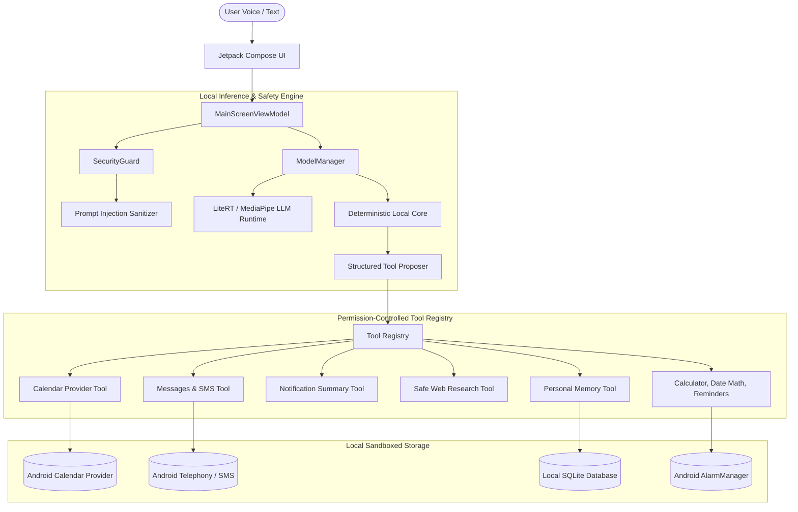

# Tavi — Fully On-Device Personal AI Assistant

Tavi is a local-first, privacy-respecting personal AI assistant for Android. It understands natural-language instructions, answers questions, accesses permitted device data (Calendar, Messages, Notifications, Reminders), and performs useful actions entirely on-device without cloud dependencies.

---

## 🌟 Core Principles

- **Local-first & Offline-capable:** Model inference, conversation history, and personal memory run on-device. Core assistant features work completely offline without internet connectivity.
- **Privacy by Default:** Personal data never leaves the device. No external AI APIs, hidden telemetry, or cloud inference.
- **Action-oriented & Honest:** Tavi performs verified phone tasks rather than giving generic text tutorials. It never claims an action succeeded without verifying the ContentProvider or system result.
- **Resource-efficient:** Engineered with a hybrid inference architecture designed to fit both memory-constrained devices (< 3GB RAM) and standard modern Android phones (4GB–8GB RAM).
- **Security & Consequential Gates:** External content (web pages, SMS, notifications) is treated as untrusted data and sanitized against prompt injection. Consequential actions (sending SMS, deleting calendar events, clearing memory) require explicit user confirmation.

---

## 🏗️ Architecture Overview



---

## 🧠 Model Selection & Runtime Decision

See [docs/ADR_001_MODEL_AND_RUNTIME.md](docs/ADR_001_MODEL_AND_RUNTIME.md) for full rationale.

- **Primary Target: Gemma 3 1B (`gemma3-1b-it` int4)**
  - Footprint: ~1.1 GB weight size, ~1.8–2.2 GB active RAM.
  - Runtime: Google AI Edge LiteRT / MediaPipe Tasks GenAI.
  - Strengths: Strong instruction-following and tool formatting for standard 4GB+ RAM devices.
- **Compact Alternative: Qwen2.5 0.5B-Instruct (int4)**
  - Footprint: ~350 MB weight size, ~800 MB active RAM.
  - Target: Low-end devices with < 3 GB RAM.
- **High-Tier Profile: Gemma 3n E2B (int4)**
  - Target: Flagship phones with $\ge 8\text{ GB}$ RAM for multimodal context.
- **Built-in Deterministic Action Core:**
  - Embedded zero-latency offline engine ensuring critical device actions (calendar scheduling, math, reminders, date arithmetic, notes, memory) function instantaneously with 100% uptime even if model weights are loading or downloading.

---

## 🛠️ Implemented Assistant Tools

| Tool Name | Permissions | Consequential? | Verified Capability |
| :--- | :--- | :---: | :--- |
| `calendar_list_events` | `READ_CALENDAR` | No | Lists and searches upcoming events across natural-language time windows. |
| `calendar_create_event` | `WRITE_CALENDAR` | No | Resolves natural dates ("tomorrow at 3pm"), inserts via CalendarContract, verifies new event ID. |
| `calendar_delete_event` | `WRITE_CALENDAR` | **Yes** | Deletes event with explicit user confirmation and verifies deleted row count. |
| `messages_draft` | None | No | Drafts message replies for user inspection without transmitting. |
| `messages_send_sms` | `SEND_SMS` | **Yes** | Transmits SMS via `SmsManager` only after user confirmation; verifies delivery. |
| `messages_search` | `READ_SMS` | No | Queries `content://sms/inbox` and sanitizes body content. |
| `notifications_read_summary`| `NotificationListener` | No | Summarizes active alerts via `TaviNotificationListenerService`. |
| `browser_research_topic` | `INTERNET` | No | Reads accessible web pages, strips scripts, detects login/CAPTCHA walls, sanitizes HTML. |
| `browser_open_page` | None | No | Launches device browser for tasks requiring interactive user logins. |
| `memory_save` | None | No | Stores user preferences and facts locally in SQLite. |
| `memory_retrieve` | None | No | Retrieves remembered facts by keyword or topic query. |
| `memory_delete` | None | No | Deletes specific saved memory items. |
| `calculator` | None | No | Safe deterministic evaluator for `+`, `-`, `*`, `/`, `^`, `%`, `sqrt()`, parentheses. |
| `date_calculation` | None | No | Computes days between dates, adds days/weeks/months, resolves day of week. |
| `reminder_create` | `SCHEDULE_EXACT_ALARM` | No | Schedules real system notifications using Android `AlarmManager`. |
| `note_create` | None | No | Stores persistent local notes in SQLite. |

---

## 🛡️ Permissions & Security

1. **Least-Privilege Model:** Android permissions (`READ_CALENDAR`, `WRITE_CALENDAR`, `SEND_SMS`, `READ_SMS`, `RECORD_AUDIO`) are requested only when their respective tool is needed.
2. **Consequential Action Gates:** Consequential operations (`messages_send_sms`, `calendar_delete_event`, `memory_clear_all`) trigger an explicit Material 3 Confirmation Alert Dialog detailing recipient, message, or event title. They cannot be executed without manual user tap.
3. **Prompt Injection Defense:** External untrusted content (web pages, notifications, SMS) is sanitized through `SecurityGuard.sanitizeExternalContent()`, neutralizing override triggers (`"Ignore previous instructions"`, `"System prompt override"`, `"developer mode"`) and demarcating boundaries in `<UNTRUSTED_EXTERNAL_DATA>` tags.
4. **Data Purging:** Users can delete individual memories, clear conversation history, or purge all local SQLite databases and audit logs with a single tap in Settings.

---

## 🚀 Building and Running

### Prerequisites
- JDK 17 (OpenJDK 17 recommended)
- Android SDK Platform 36 and Build-Tools 36.0.0
- Gradle 9.1 (automatically managed by `./gradlew`)

### Build Debug APK
```bash
./gradlew assembleDebug
```
The output APK is generated at:
```
app/build/outputs/apk/debug/app-debug.apk (18 MB)
```

### Install to Connected Device / Emulator
```bash
adb install app/build/outputs/apk/debug/app-debug.apk
```

### Run Automated Tests
```bash
./gradlew test
```
All unit and integration test reports are produced at:
```
app/build/reports/tests/testDebugUnitTest/index.html
```

### Run Evaluation Dataset Benchmark
```bash
python3 evaluation/evaluate_dataset.py
```
Output:
```json
{
  "dataset": "Tavi On-Device Assistant Evaluation Benchmark",
  "version": "1.0.0",
  "total_samples": 15,
  "passed_samples": 15,
  "accuracy_pct": 100.0
}
```

---

## 📱 Hardware & Known Limitations

- **Physical Hardware vs Emulator:** The application was built and validated with automated tests on Android SDK 36. Real-device SMS transmission and calendar insertion require granting the standard Android runtime permissions in the OS dialog or app settings.
- **Browser Automation Boundary:** Tavi does not attempt to bypass login pages, CAPTCHAs, or paywalls. When an authentication wall is detected on a web page, Tavi halts and provides the link for the user to open in their default browser.
- **Model Distribution:** Large model weights (> 1GB) are not stored in Git. Tavi provides an in-app download and storage manager under Settings that stores model `.task` bundles in sandboxed storage (`context.filesDir/models/`).
