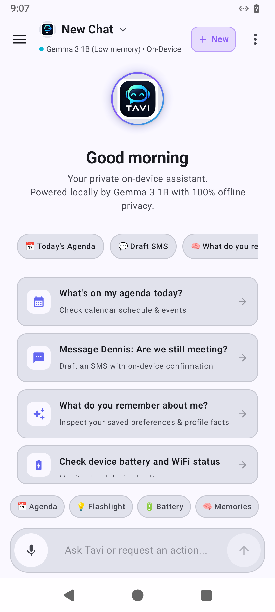
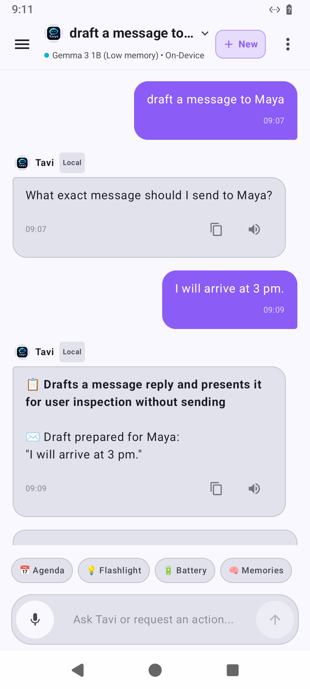
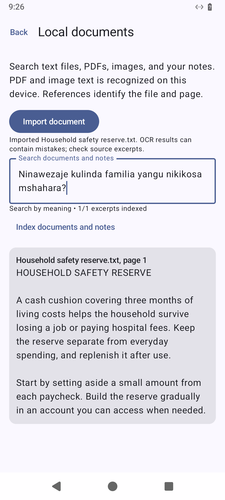
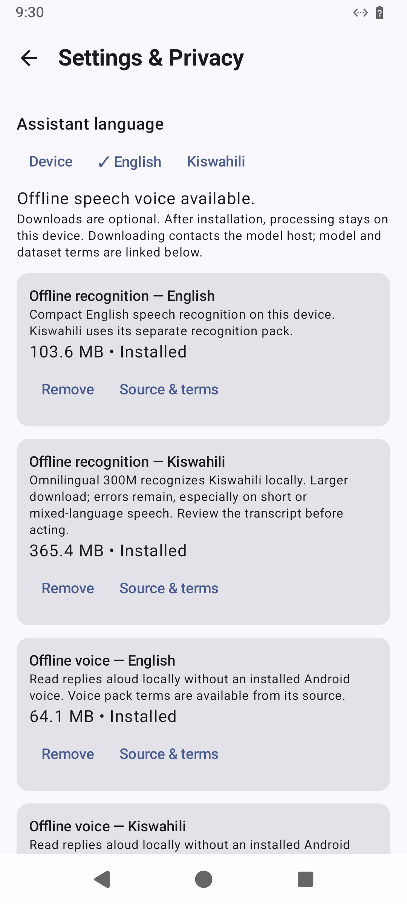
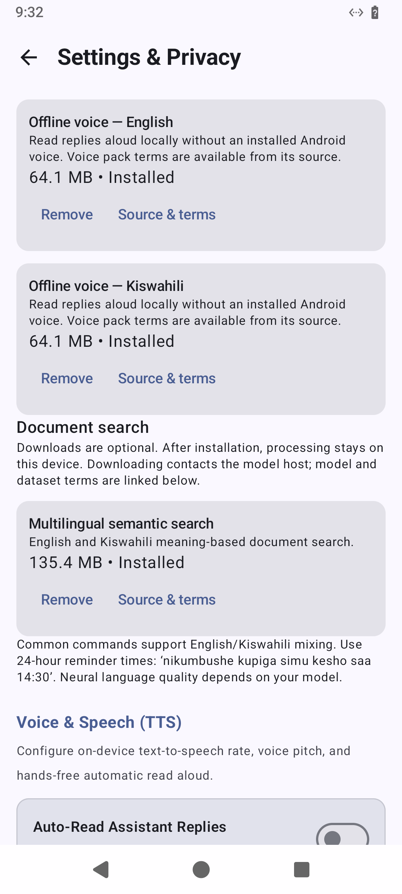
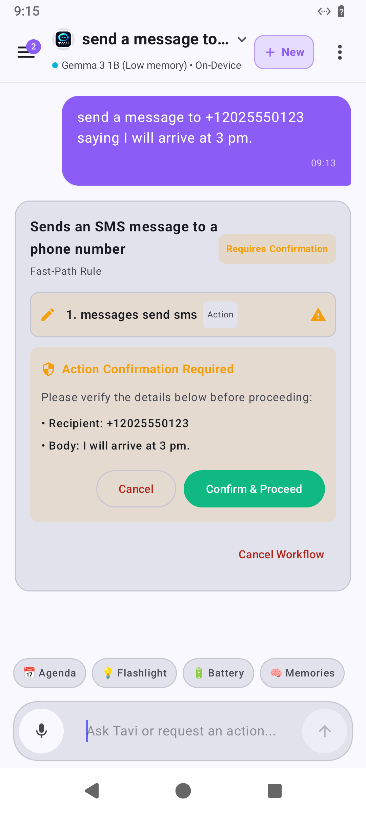
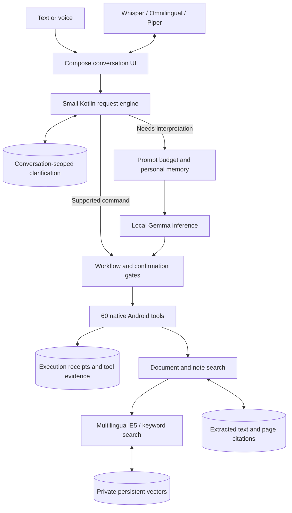

<div align="center">


# Tavi

### A private Android assistant that works on your device

Local conversation · English & Kiswahili speech · Cited document search · Android actions

[](#build-and-install)
[](#build-and-install)
[](#validation)
[](LICENSE)

[Features](#what-tavi-can-do) · [Screenshots](#screenshots) · [Get started](#get-started) · [Build](#build-and-install) · [Validation](#validation) · [Contribute](CONTRIBUTING.md)

</div>

Tavi combines a small Kotlin request engine with optional local AI models. Common commands run without loading language-model weights. Conversation, speech, personal memory, OCR, and document search run locally; Android tools connect that assistance to your phone.

No cloud AI service or analytics is used. Optional downloads contact model hosts, and requested browser, messaging, calling, or sharing actions use their respective services.

## Screenshots

These screenshots show the current app running on an Android 14 x86_64 cloud device, captured on **8 November 2026** at **1080 × 2400**. All displayed conversations and documents are demonstration content. [Capture details and reproduction steps](assets/screenshots/README.md). Select an image to open the full-resolution capture.

<table>
  <tr>
    <th>Start a local conversation</th>
    <th>Continue a clarification</th>
    <th>Search across languages</th>
  </tr>
  <tr>
    <td><a href="assets/screenshots/08_current_welcome.png"></a></td>
    <td><a href="assets/screenshots/09_clarification_followup.png"></a></td>
    <td><a href="assets/screenshots/13_semantic_kiswahili.png"></a></td>
  </tr>
  <tr>
    <td>Action starters, conversation history, and text or voice input.</td>
    <td>The request engine keeps missing details scoped to the conversation.</td>
    <td>Meaning-based retrieval with current source text and page references.</td>
  </tr>
  <tr>
    <th>Install offline recognition</th>
    <th>Choose local voices</th>
    <th>Review before sending</th>
  </tr>
  <tr>
    <td><a href="assets/screenshots/11_offline_recognition.png"></a></td>
    <td><a href="assets/screenshots/12_offline_voices.png"></a></td>
    <td><a href="assets/screenshots/10_action_confirmation.png"></a></td>
  </tr>
  <tr>
    <td>Separate verified packs for each recognition language.</td>
    <td>Optional speech output that works without an Android voice provider.</td>
    <td>Inspect the action and message before approving it.</td>
  </tr>
</table>

## What Tavi can do

| Feature | How it works |
| :--- | :--- |
| **Small request engine** | A bounded Kotlin router handles common English/Kiswahili commands for time, calculations, device status, alarms, timers, notes, documents, contacts, settings, and messages. Supported commands run before neural planning. |
| **Persistent clarification** | Missing alarm time, timer duration, message recipient, or exact message text stays with its conversation for ten minutes. Follow-ups survive an app restart. Completion preserves the action's confirmation requirement. |
| **Independent offline speech** | Whisper Tiny recognizes English; Omnilingual 300M recognizes Kiswahili. Piper supplies English/Kiswahili voices. Capture uses a silence endpoint; playback and follow-up listening have explicit stop controls. |
| **Semantic document search** | Import text, Markdown, PDFs, or images. Bundled English/Kiswahili OCR extracts text. Optional multilingual E5 Small retrieves paraphrases across documents and notes, with file/page citations and persistent vectors. Keyword search remains available without the pack. |
| **Local conversation** | Gemma 3 1B IT or Gemma 4 E2B through LiteRT-LM, with MediaPipe support for compatible bundles. Models load when needed and release under memory pressure. |
| **Personal memory** | Local SQLite memory with recall, provenance, correction, and deletion. Conversations retain tool evidence and execution receipts. |
| **Reminders and routines** | Editable schedules, recurrence, snooze, and reboot restoration. Android notification permissions and alarm access affect delivery. |
| **Android integration** | 60 registered tools across 15 categories, typed argument validation, permission checks, and confirmation for tools such as SMS sending, direct calls, and note deletion. |
| **Screen assistance** | A local model can plan actions against visible accessibility nodes in Settings, Chrome, and Firefox, with scoped pause/resume and stop controls. |

### Try the request engine

| Enter | Result |
| :--- | :--- |
| `What time is it?` | Reads the device clock through the native tool. |
| `Calculate 145 * 12` | Evaluates the expression locally. |
| `Set an alarm` | Asks for an exact time; answer with `07:30`. |
| `Draft a message to Maya` | Asks for the exact text; your next answer completes the draft. |
| `Saa ngapi?` | Routes the supported Kiswahili clock command. |

Clarification slots expire after ten minutes and clear on completion or cancellation. Supported actions pass through the shared workflow and permission checks. Opening a system app is reported as a handoff; an SMS dispatch is distinguished from Android's send/delivery callbacks.

### Speech and search packs

Downloads are optional, resumable, and pinned to exact revisions, sizes, and SHA-256 hashes. Incomplete or modified packs cannot load. Files stay in private app storage and can be removed in Settings.

| Pack | Download size | Purpose |
| :--- | ---: | :--- |
| Whisper Tiny int8 | 103.6 MB | English speech recognition |
| Omnilingual 300M CTC int8 | 365.4 MB | Kiswahili speech recognition |
| Piper Lessac | 64.1 MB | English speech output |
| Piper Lanfrica | 64.1 MB | Kiswahili speech output |
| Multilingual E5 Small int8 | 135.4 MB | Document and note search by meaning |

Recognition uses the pack for the selected language. Without it, a compatible Android 12+ on-device provider can supply recognition; local Android voices can also supply speech output. Text remains available. The Kiswahili voice is Congolese `sw_CD`.

Semantic search creates at most 24 new excerpt embeddings per request. **Index documents and notes** processes the whole library in cancellable batches, retaining completed work. The screen reports coverage. Deleting a source removes its vectors; removing the semantic pack clears the semantic index.

See [pack sources, hashes, runtime details, and licenses](docs/LOCAL_MODEL_PACKS.md).

## Get started

1. Install a debug APK built for your device. The native runtimes support **ARM64** and **x86_64**.
2. Open Tavi and try a common text command. The small request engine works without language-model weights.
3. Open **Settings → Local Language Model** for conversation. Download the pinned Gemma 3 1B bundle, or import a trusted compatible `.litertlm` / `.task` file. Gemma 4 E2B requires a trusted import or a hosted artifact with the necessary authentication and publisher checksum.
4. In **Settings → Assistant language**, choose English, Kiswahili, or Device. Download recognition and voice packs for the language you want.
5. For search by meaning, install **Multilingual semantic search** under **Document search**. Open **Local document library**, import a file, and tap **Index documents and notes**.
6. Grant Android permissions when a feature needs them. Default assistant invocation and accessibility require Android special access; review those controls in the capability manager.

Gemma 3's pinned LiteRT-LM file is approximately 584 MB (558 MiB); Gemma 4 E2B is approximately 2.58 GB. Available RAM, Android version, and runtime compatibility determine which model can run. [Device and runtime limitations](LIMITATIONS.md).

## Build and install

Use **JDK 17**, Android SDK **36**, and Android Studio compatible with the repository's Android Gradle Plugin. The minimum Android version is API 24 (Android 7.0); native runtime compatibility still needs validation on each supported device.

```bash
git clone https://github.com/MosetiReagan/Tavi.git
cd Tavi
./gradlew assembleDebug -PtaviTargetAbi=arm64-v8a
adb install --no-streaming -r app/build/outputs/apk/debug/app-debug.apk
adb shell am start -n com.tavi.assistant/com.example.tavi.MainActivity
```

Use `-PtaviTargetAbi=x86_64` for an x86_64 device. Omit the property to package both supported architectures. The debug APK is signed with the development key. `./gradlew assembleRelease` produces a minified release; configure `KEYSTORE_FILE`, `KEYSTORE_PASSWORD`, `KEY_ALIAS`, and `KEY_PASSWORD` through local environment variables or Gradle properties to sign it for distribution.

Gradle retrieves the pinned Sherpa speech AAR from its publisher and checks SHA-256 before building. For an offline build with cached dependencies, pass `-PtaviSpeechAar=/absolute/path/to/verified-sherpa.aar`; the same verification applies.

## Validation

The **8 November 2026** validation recorded:

| Check | Result |
| :--- | :--- |
| JVM regression tests | **234 passed across 42 suites**; no failures or skips |
| Android feature tests | **12 passed** on Android 14 / x86_64 |
| Existing Android acceptance tests | **16 passed** in a separate fresh-process run |
| Tokenizer compatibility | **114 reference cases passed** on Android |
| Debug lint | **0 errors**, 192 warnings, 2 hints |
| ARM64 packaging | Debug and minified release built; debug signature and release ZIP alignment verified |

Android coverage includes real Gemma, Whisper, Omnilingual, Piper, and E5 inference, persistent clarifications, semantic retrieval, OCR, document deletion, receipts, reminders, and Compose rendering. [Full validation, raw results, and APK checksums](docs/validation/2026-11-08-android-cloud.md).

Kiswahili recognition improved to **21/83 word errors (25.3%)** on three preselected human FLEURS recordings, compared with Whisper Tiny's 83/83. This small sample does not establish overall accuracy. Short synthetic Kiswahili commands remained unreliable. OCR and semantic retrieval can also be inaccurate; check the transcript and cited source before consequential actions.

Physical ARM phone latency, microphone behavior, battery, thermals, and real SIM delivery remain unmeasured for these additions. Upstream LiteRT-LM Kotlin metadata warnings remain. No comparison establishing a global ranking has been performed.

Run checks with:

```bash
./gradlew testDebugUnitTest lintDebug assembleDebug assembleDebugAndroidTest
./gradlew connectedDebugAndroidTest \
  -Pandroid.testInstrumentationRunnerArguments.notClass=com.example.tavi.benchmark.DeviceBenchmark
```

Install the optional packs and verified language-model weights before running the relevant native tests; absent packs cause those tests to skip. The recorded runs had their dependencies installed and no skips. Run `bash scripts/run_benchmark.sh` on an authorized physical device for inference measurements. [Benchmark guide and cloud results](benchmarks/README.md).

## Architecture



LiteRT-LM 0.18.1 and MediaPipe Tasks GenAI 0.10.27 provide language-model runtimes. Sherpa 1.12.20 supplies speech inference; ONNX Runtime Android 1.21.0 supplies E5 embeddings. Context budgeting accounts for the complete prompt within the configured 2,048-token window. Native speech and embedding sessions unload after 45 seconds idle or memory pressure.

## Native tools

The directory is generated from registered `AssistantTool` implementations. Android providers, permissions, and installed applications determine availability. “Direct” means the tool does not declare its own confirmation requirement; workflow and permission checks still apply.

<details>
<summary>Browse all 60 registered tools across 15 categories</summary>

<!-- TOOL_TABLE_START -->

### Complete Native Tool Directory (60 On-Device Tools)

| Category | Tool Identifier | Consequential Gate | Purpose |
| :--- | :--- | :---: | :--- |
| **ACCESSIBILITY** | `accessibility_perform_action` | ⚡ Direct | Performs global system UI navigation actions like pressing back, going home, showing recents, opening notifications, or quick settings. |
| **ACCESSIBILITY** | `accessibility_read_screen` | ⚡ Direct | Inspects the visible text and UI elements currently displayed on the screen with strict password and privacy redactions. |
| **ACCESSIBILITY** | `screen_agent_resume` | 🔒 Required | Resume the exact paused screen action after explicit user confirmation; rejects expired or changed targets. |
| **ACCESSIBILITY** | `screen_agent_run` | 🔒 Required | Use a local model to navigate Settings, Chrome, or Firefox with exact visible nodes and individual confirmations. |
| **APPLICATIONS** | `app_launch` | ⚡ Direct | Launches an installed application by its name or package name. |
| **APPLICATIONS** | `app_list_launchable` | ⚡ Direct | Lists visible launchable applications installed on the device. |
| **APPLICATIONS** | `app_open_settings` | ⚡ Direct | Opens the Android system App Info settings page for Tavi or a specified app. |
| **APPLICATIONS** | `browser_open_url` | ⚡ Direct | Opens a web URL in the device's default web browser. |
| **APPLICATIONS** | `share_content` | ⚡ Direct | Shares text content using the Android system share sheet. |
| **CALENDAR** | `calendar_create_event` | ⚡ Direct | Creates a new calendar event with natural date/time resolution and conflict detection. |
| **CALENDAR** | `calendar_delete_event` | 🔒 Required | Deletes a calendar event by its event ID. This is a consequential action that requires user confirmation. |
| **CALENDAR** | `calendar_get_event` | ⚡ Direct | Inspects details of a single calendar event by eventId. |
| **CALENDAR** | `calendar_list_events` | ⚡ Direct | Lists or searches upcoming calendar events within an optional date range or query. |
| **CALENDAR** | `calendar_update_event` | ⚡ Direct | Updates an existing calendar event title, time, or location. |
| **CLOCK** | `alarm_create` | ⚡ Direct | Sets an alarm in the Android system Clock app. |
| **CLOCK** | `alarm_show` | ⚡ Direct | Opens the device Clock app to display all configured alarms. |
| **CLOCK** | `clock_query_time` | ⚡ Direct | Queries the current device time, timezone, UTC offset, and locale. |
| **CLOCK** | `date_calculation` | ⚡ Direct | Performs deterministic date math (e.g., days until a future date, adding days/weeks, timezone offset). |
| **CLOCK** | `reminder_create` | ⚡ Direct | Schedules an Android system reminder notification at a designated natural time. |
| **CLOCK** | `timer_set` | ⚡ Direct | Starts a countdown timer in the device Clock app. |
| **CONNECTIVITY** | `network_get_status` | ⚡ Direct | Inspects local network connectivity (Wi-Fi, cellular, metered status, offline state). |
| **CONTACTS** | `contacts_create` | ⚡ Direct | Creates a new contact with display name, phone number, and optional email. |
| **CONTACTS** | `contacts_resolve` | ⚡ Direct | Resolves a contact query. If multiple ambiguous contacts match, exposes the ambiguity instead of guessing. |
| **CONTACTS** | `contacts_search` | ⚡ Direct | Searches device contacts by name or phone number to retrieve contact names and phone numbers. |
| **DEVICE** | `device_get_status` | ⚡ Direct | Reads battery level, charging state, available storage, and system platform status. |
| **DEVICE** | `device_toggle_flashlight` | ⚡ Direct | Turns the device flashlight/torch on or off. |
| **DEVICE** | `settings_open` | ⚡ Direct | Opens specific Android system Settings panels (wifi, bluetooth, display, sound, notifications, battery, apps, date, storage). |
| **FILES** | `documents_search` | ⚡ Direct | Search imported local documents and saved notes; returns source and page citations. |
| **FILES** | `files_browse_document` | ⚡ Direct | Launches the Android Storage Access Framework (SAF) document picker. |
| **FILES** | `files_export_note` | ⚡ Direct | Exports a local note via the Android system share sheet. |
| **LOCATION** | `location_get_current` | ⚡ Direct | Reads device's current foreground location coordinates if permission is granted. |
| **LOCATION** | `maps_navigate` | ⚡ Direct | Opens maps or navigation to a destination or search query. |
| **MEDIA** | `camera_launch` | ⚡ Direct | Opens the device Camera application to take a photo. |
| **MEDIA** | `media_control` | ⚡ Direct | Sends media playback control commands (play_pause, next, previous). |
| **MEDIA** | `voice_speak` | ⚡ Direct | Speaks the provided text aloud using Android Text-To-Speech. |
| **NOTES** | `calculator` | ⚡ Direct | Evaluates deterministic mathematical expressions (e.g., '145 * 12', 'sqrt(144) + 2^4'). Safe and local. |
| **NOTES** | `clipboard_copy` | ⚡ Direct | Copies text to the Android system clipboard. |
| **NOTES** | `clipboard_read` | ⚡ Direct | Reads current text content from the Android system clipboard. |
| **NOTES** | `memory_clear_all` | 🔒 Required | Permanently clears all personal memories and notes. This is a consequential action requiring user confirmation. |
| **NOTES** | `memory_delete` | ⚡ Direct | Deletes a specific remembered item from local memory by key or ID. |
| **NOTES** | `memory_record_episode` | ⚡ Direct | Records a completed task, project decision, or workflow rationale as an episodic memory for future recall. |
| **NOTES** | `memory_retrieve` | ⚡ Direct | Retrieves relevant saved personal facts, preferences, or notes from local memory. |
| **NOTES** | `memory_save` | ⚡ Direct | Saves user-approved personal preferences, facts, or notes into persistent local memory. |
| **NOTES** | `note_create` | ⚡ Direct | Creates a persistent local note. |
| **NOTES** | `note_delete` | 🔒 Required | Deletes a saved note by ID. Consequential action requiring confirmation. |
| **NOTES** | `notes_list` | ⚡ Direct | Lists or searches locally saved notes. |
| **NOTES** | `reminder_cancel` | ⚡ Direct | Cancels or deletes a scheduled reminder by title or ID. |
| **NOTES** | `reminder_list` | ⚡ Direct | Lists all upcoming active reminders scheduled on device. |
| **NOTIFICATIONS** | `notifications_dismiss` | ⚡ Direct | Dismisses a notification by its key or clears notifications. |
| **NOTIFICATIONS** | `notifications_read_summary` | ⚡ Direct | Reads authorized recent notifications and summarizes active alerts or messages. |
| **RESEARCH** | `browser_open_page` | ⚡ Direct | Opens an accessible URL in the device browser so the user can interact directly. |
| **RESEARCH** | `browser_research_topic` | ⚡ Direct | Reads accessible web page content, extracts relevant text, and supports multi-step research. Halts if login or CAPTCHA is encountered. |
| **TELEPHONY** | `call_log_search` | ⚡ Direct | Searches recent call history records. |
| **TELEPHONY** | `messages_draft` | ⚡ Direct | Drafts a message reply and presents it for user inspection without sending. |
| **TELEPHONY** | `messages_get_send_status` | ⚡ Direct | Check Android SMS send and delivery callbacks for a previous dispatch ID. |
| **TELEPHONY** | `messages_search` | ⚡ Direct | Searches explicitly permitted local SMS messages by keyword or sender. |
| **TELEPHONY** | `messages_send_sms` | 🔒 Required | Sends an SMS message to a phone number. Requires explicit user confirmation before transmission. |
| **TELEPHONY** | `phone_call` | 🔒 Required | Initiates a direct phone call to a contact or number. Consequential action requiring explicit user confirmation. |
| **TELEPHONY** | `phone_dial` | ⚡ Direct | Opens the device dialer with the requested number prefilled. Does not place the call automatically. |
| **USAGE** | `usage_get_stats` | ⚡ Direct | Retrieves authorized app usage statistics, daily screen time, and recently used apps. |

<!-- TOOL_TABLE_END -->

</details>

Regenerate the directory with `python3 scripts/gen_tool_table.py --update-readme`.

## Privacy and control

Conversation history, personal memory, extracted documents, clarification slots, and vectors stay in private SQLite databases. Raw microphone recordings remain in memory. Android backup rules exclude private databases and files. Users can inspect and remove retained data in the app.

Accessibility redacts password fields, and heuristic filters screen external content and personal memory. These filters have limits and do not guarantee detection of every secret or malicious instruction. Screen automation is restricted to supported applications; default SMS/dialer roles are disabled.

[Privacy policy](PRIVACY.md) · [Security policy](SECURITY.md) · [Operational limits](LIMITATIONS.md)

## Explore the project

| Path | Contents |
| :--- | :--- |
| [`app/src/main/java/com/example/tavi/engine`](app/src/main/java/com/example/tavi/engine) | Request routing, clarification, model acquisition, and local inference |
| [`app/src/main/java/com/example/tavi/voice`](app/src/main/java/com/example/tavi/voice) | Independent recognition, synthesis, playback, and voice sessions |
| [`app/src/main/java/com/example/tavi/documents`](app/src/main/java/com/example/tavi/documents) | Import, OCR, tokenization, semantic indexing, and source citations |
| [`app/src/main/java/com/example/tavi/tools`](app/src/main/java/com/example/tavi/tools) | Native Android tools and registry |
| [`app/src/main/java/com/example/tavi/workflow`](app/src/main/java/com/example/tavi/workflow) | Execution plans, confirmations, and receipts |
| [`docs/validation`](docs/validation) | Reproducible validation records and raw evidence |
| [`assets/screenshots`](assets/screenshots) | Current app captures, provenance, and older screenshots |
| [`training`](training/README.md) | QLoRA dataset/training/export experiments; exported compatibility and quality require validation |

Contributions are welcome. Read [CONTRIBUTING.md](CONTRIBUTING.md), [CHANGELOG.md](CHANGELOG.md), and the [model/runtime decision record](docs/ADR_001_MODEL_AND_RUNTIME.md).

## License

Tavi's source is licensed under [Apache 2.0](LICENSE). Models, speech data, and bundled runtimes have their own terms, including eSpeak NG's GPL-3.0-or-later requirements. Review [third-party provenance and distribution terms](docs/LOCAL_MODEL_PACKS.md) before distributing an APK.
