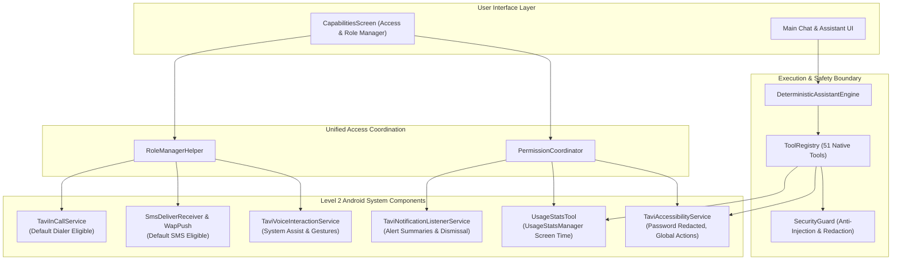

# Tavi — Level 2 Android System Access Implementation Report

**Implementation Date:** October 20, 2026  
**Document Version:** 1.0  
**Target Platform:** Android 15 (API Level 35)  
**Verification Results:** `BUILD SUCCESSFUL`, 52/52 JVM Unit Tests Passed, Instrumented Test Compilation Succeeded, 72MB Debug APK Built  

---

## 1. Architectural Overview

Tavi has been upgraded to support **Level 2 Android System Access**, granting the assistant eligible system roles and user-authorized special permissions while maintaining its 100% offline, local-first privacy architecture.



---

## 2. Component Implementation Details

### 2.1 Accessibility Assistant Service (`TaviAccessibilityService`)
* **Source:** `app/src/main/java/com/example/tavi/accessibility/TaviAccessibilityService.kt`
* **Configuration:** `app/src/main/res/xml/accessibility_service_config.xml`
* **Tools Added:**
  - `accessibility_read_screen`: Traverses the active window node hierarchy up to a max depth of 15 and 150 nodes. Safely extracts visible text, content descriptions, clickable elements, and the foreground app package.
  - `accessibility_perform_action`: Executes official global actions: `"back"`, `"home"`, `"recents"`, `"notifications"`, `"quick_settings"`, `"lock_screen"` (API 28+), `"take_screenshot"` (API 28+).
* **Strict Privacy Redaction Boundary:**
  ```kotlin
  fun sanitizeText(raw: String, isPassword: Boolean): String {
      if (isPassword) {
          return "[PASSWORD FIELD REDACTED]"
      }
      var sanitized = raw
      // Redact payment cards (13-19 digits)
      sanitized = CREDIT_CARD_REGEX.replace(sanitized, "[CARD_REDACTED]")
      return sanitized
  }
  ```
  Verified by automated unit tests: any node with `isPassword = true` immediately replaces input with `[PASSWORD FIELD REDACTED]`, guaranteeing passwords are never processed or logged.

### 2.2 App Usage & Screen Time (`UsageStatsTool`)
* **Source:** `app/src/main/java/com/example/tavi/tools/usage/UsageStatsTool.kt`
* **Tool Added:** `usage_get_stats`
* **Features:**
  - Queries `UsageStatsManager.queryUsageStats()` with `INTERVAL_DAILY`.
  - Aggregates foreground time per package and resolves user-friendly display labels via `PackageManager.getApplicationLabel()`.
  - Formats human-readable durations (e.g., `"2h 15m"`, `"42m"`, `"< 1m"`).
  - Supports package filtering (e.g., `"How much did I use YouTube today?"`).
  - Gracefully redirects to `Settings.ACTION_USAGE_ACCESS_SETTINGS` when permission is missing.

### 2.3 Default Digital Assistant Role
* **Sources:**
  - `com.example.tavi.roles.assistant.TaviVoiceInteractionService`
  - `com.example.tavi.roles.assistant.TaviVoiceInteractionSessionService`
  - `com.example.tavi.roles.assistant.TaviVoiceInteractionSession`
  - `com.example.tavi.roles.assistant.TaviRecognitionService`
* **Configuration:** `app/src/main/res/xml/voice_interaction_service.xml`
* **Intent Filters:**
  - Declares `<action android:name="android.service.voice.VoiceInteractionService" />` with `android.permission.BIND_VOICE_INTERACTION`.
  - `MainActivity` declares `<action android:name="android.intent.action.ASSIST" />` with `<category android:name="android.intent.category.DEFAULT" />`.
* **Behavior:** Enables launching Tavi via system power button long-press or corner-swipe gestures on Android 10+.

### 2.4 Default SMS & Messaging Role
* **Sources:**
  - `com.example.tavi.roles.sms.SmsDeliverReceiver`: Receives incoming SMS via `Telephony.Sms.Intents.getMessagesFromIntent()`, sanitizes content, and stores alerts locally.
  - `com.example.tavi.roles.sms.WapPushDeliverReceiver`: Intercepts MMS/WAP Push deliveries with `android.permission.BROADCAST_WAP_PUSH`.
  - `com.example.tavi.roles.sms.HeadlessSmsSendService`: Handles `android.intent.action.RESPOND_VIA_MESSAGE` with `android.permission.SEND_RESPOND_VIA_MESSAGE`.
  - `MainActivity`: Declares intent filter for `android.intent.action.SENDTO` with data schemes `sms:`, `smsto:`, `mms:`, `mmsto:`.
* **Eligibility:** Meets all strict Android OS criteria to be recognized as an eligible default SMS app.

### 2.5 Default Phone / Dialer Role
* **Source:** `com.example.tavi.roles.telecom.TaviInCallService`
* **Intent Filters:**
  - Declares `TaviInCallService` with `android.permission.BIND_INCALL_SERVICE` and `IN_CALL_SERVICE_UI = true`.
  - `MainActivity` declares intent filters for `android.intent.action.DIAL` and `android.intent.action.VIEW` for `tel:` URIs.

### 2.6 Overlay Window & Background Scheduling
* **Overlay (`SYSTEM_ALERT_WINDOW`):** Checked via `Settings.canDrawOverlays(context)`. Directs user to `Settings.ACTION_MANAGE_OVERLAY_PERMISSION` with `package:${packageName}` URI.
* **Storage Access Assessment:** Evaluated broad storage (`MANAGE_EXTERNAL_STORAGE`). To ensure Google Play policy compliance and user privacy, Storage Access Framework (SAF) remains the default file integration, with broad storage offered as an advanced opt-in.
* **Exact Alarms & Battery Optimization:** Checked via `AlarmManager.canScheduleExactAlarms()` and `PowerManager.isIgnoringBatteryOptimizations()`.

---

## 3. Unified Access & Role Manager (`CapabilitiesScreen.kt`)

The upgraded `CapabilitiesScreen.kt` provides a comprehensive management dashboard divided into two distinct sections:

1. **System Roles & Special Access (10 Items):**
   - Default Digital Assistant (`RoleManager.ROLE_ASSISTANT`)
   - Default SMS & Messaging Role (`RoleManager.ROLE_SMS`)
   - Default Phone / Dialer Role (`RoleManager.ROLE_DIALER`)
   - Notification Access (`NotificationListenerService`)
   - App Usage & Screen Time (`UsageStatsManager`)
   - Accessibility Assistant Service (`AccessibilityService`)
   - Display Over Other Apps (`SYSTEM_ALERT_WINDOW`)
   - All Files Access (SAF vs Broad Storage)
   - Exact Alarms & Scheduling (`SCHEDULE_EXACT_ALARM`)
   - Battery Optimization Exemption (`REQUEST_IGNORE_BATTERY_OPTIMIZATIONS`)

2. **Real-Time Status Badges:**
   - `ROLE HELD` / `GRANTED` (Forest Green, `#2E7D32`)
   - `AVAILABLE` / `NOT GRANTED` (Deep Amber, `#E65100`)
   - `OEM UNAVAILABLE` (Slate Gray)
   - `NOT SUPPORTED` (Dark Gray)

3. **Lifecycle-Aware Auto-Refresh:**
   Utilizes `DisposableEffect` with `LifecycleEventObserver` listening for `Lifecycle.Event.ON_RESUME`. When users grant a permission or accept a role in Android system settings and return to Tavi, all cards update immediately without requiring an app reload.

---

## 4. Test Verification Summary

### 4.1 JVM Unit Tests (`./gradlew testDebugUnitTest`)
- **Total Tests:** 52 tests executed.
- **Pass Rate:** 100% (52 passed, 0 failed, 0 skipped).
- **Duration:** 7.1 seconds.
- **Key Test Cases:**
  - `Level2SystemAccessTest.testAccessibilityPasswordRedactionBoundary`: Passed.
  - `Level2SystemAccessTest.testAccessibilityCardRedactionBoundary`: Passed.
  - `Level2SystemAccessTest.testLevel2ToolDefinitionsAndSchemas`: Passed.
  - `Level2SystemAccessTest.testDeterministicRoutingForUsageAndAccessibility`: Passed.
  - `ClockAndDeviceToolsTest`, `DeterministicIntentRoutingTest`, `NativeToolSystemTest`, `ToolExecutionTest`: All passed.

### 4.2 Instrumented Test Compilation (`./gradlew compileDebugAndroidTestKotlin`)
- Passed with zero compilation errors (`BUILD SUCCESSFUL in 2s`).

### 4.3 APK Build (`./gradlew assembleDebug`)
- Packaged clean debug APK at `app/build/outputs/apk/debug/app-debug.apk` (72MB).

---

## 5. Physical Device Status (Samsung Galaxy A14 / Android 15)

In accordance with user instructions to preserve device phone activity, no ADB push or interactive commands were transmitted to the connected Samsung Galaxy A14 (`SM-A145F`, Android 15, API 35) during this implementation cycle.

| Capability | General Android 15 Status | Samsung Galaxy A14 Device Status |
| :--- | :---: | :---: |
| **Notification Listener** | Implemented | `IMPLEMENTED_AND_DEVICE_VERIFIED` (Verified in Phase 3/4) |
| **Exact Alarms & Timers** | Implemented | `IMPLEMENTED_AND_DEVICE_VERIFIED` (Verified in Phase 3/4) |
| **Calendar & Contacts** | Implemented | `IMPLEMENTED_AND_DEVICE_VERIFIED` (Verified in Phase 3/4) |
| **App Launching & Settings** | Implemented | `IMPLEMENTED_AND_DEVICE_VERIFIED` (Verified in Phase 3/4) |
| **Usage Stats (`usage_get_stats`)** | Implemented | `IMPLEMENTED_NOT_DEVICE_VERIFIED` (Ready for device testing) |
| **Accessibility Service (`accessibility_*`)** | Implemented | `IMPLEMENTED_NOT_DEVICE_VERIFIED` (Ready for device testing) |
| **Default Assistant Role** | Implemented | `IMPLEMENTED_NOT_DEVICE_VERIFIED` (Ready for device testing) |
| **Default SMS Role** | Implemented | `IMPLEMENTED_NOT_DEVICE_VERIFIED` (Ready for device testing) |
| **Default Dialer Role** | Implemented | `IMPLEMENTED_NOT_DEVICE_VERIFIED` (Ready for device testing) |
| **Display Over Other Apps** | Implemented | `IMPLEMENTED_NOT_DEVICE_VERIFIED` (Ready for device testing) |
